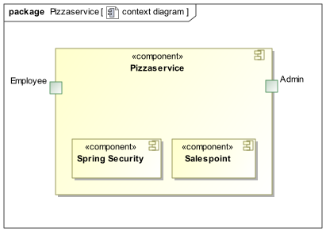
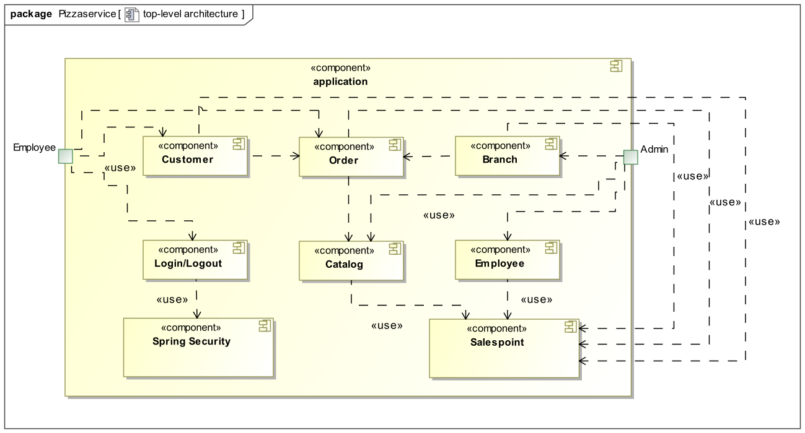
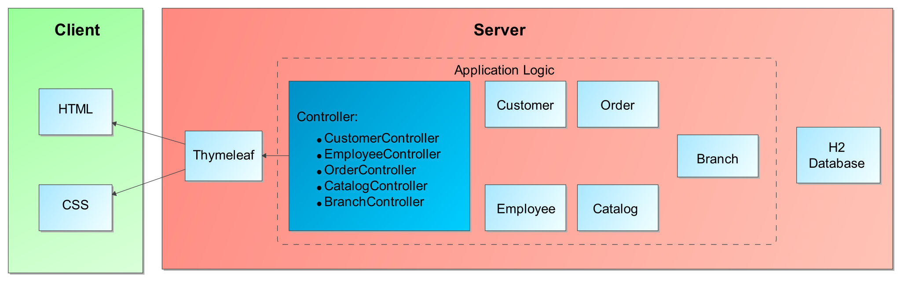
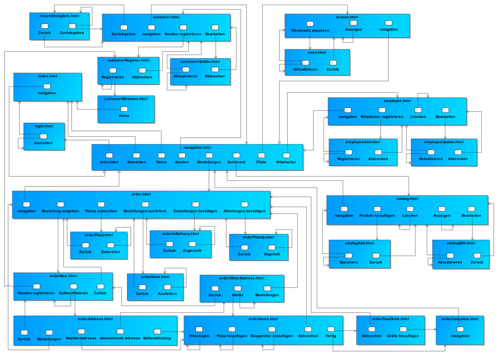
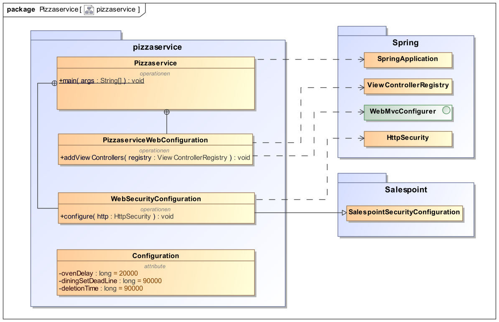
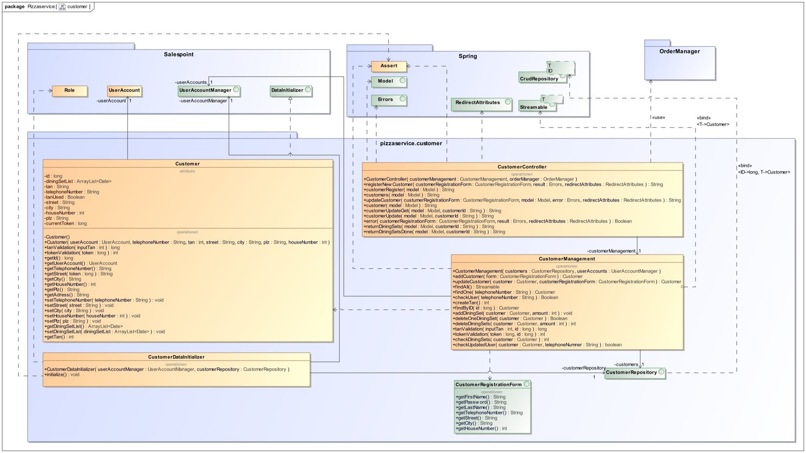
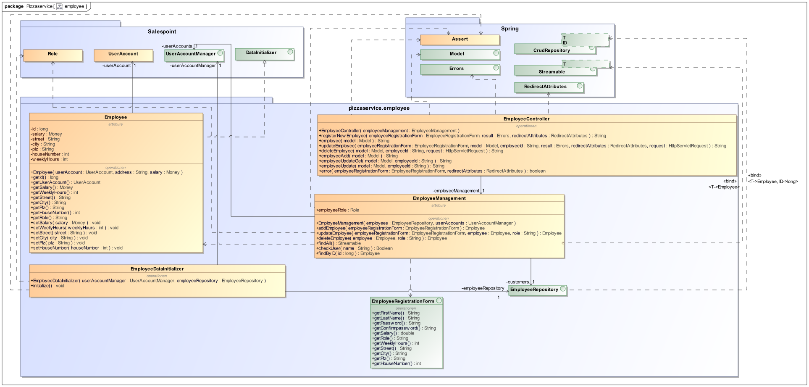
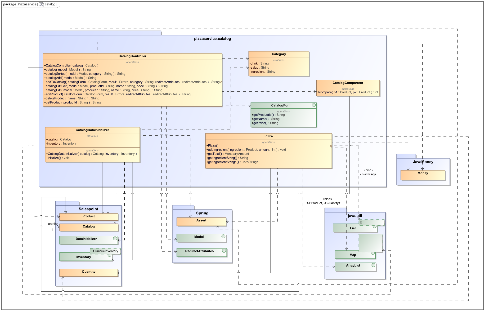
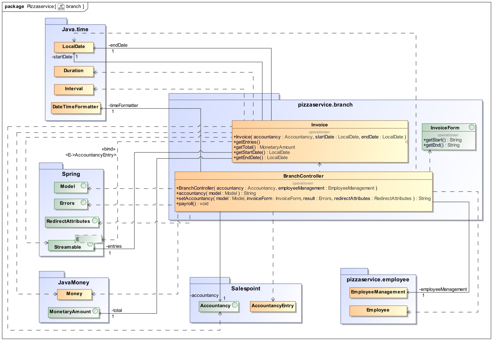
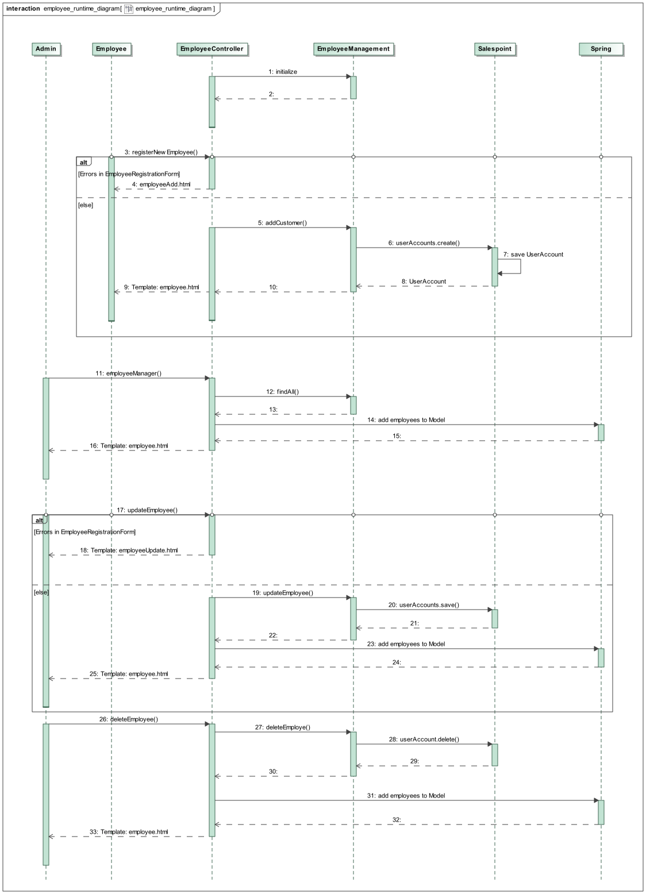

= Entwicklerdokumentation
:toc: macro
:toc-title:

[options="header"]
[cols="1, 3, 3"]
|===
|Version | Bearbeitungsdatum   | Autor
|0.1	 | 28.11.2020          | Andrej Bereza
|0.2     | 28.11.2020          | Andrej Bereza
|0.3     | 28.11.2020          | Andrej Bereza
|0.4     | 29.11.2020          | Andrej Bereza
|0.5     | 29.11.2020          | Ludwig Pauly
|1.0     | 29.11.2020          | Andrej Bereza, Ludwig Pauly, Dmytro Tyschenko, Friedemann Weickert (Serafina Loeffelholz -> Testplan)
|1.1     | 13.01.2021          | Andrej Bereza, Ludwig Pauly, Dmytro Tyschenko, Friedemann Weickert, Serafina Loeffelholz
|1.2     | 29.01.2021          | Andrej Bereza, Ludwig Pauly, Dmytro Tyschenko, Friedemann Weickert, Serafina Loeffelholz
|===

[discrete]
== Inhaltsverzeichnis
toc::[]

== 1. Einführung und Ziele
=== 1.1 Aufgabenstellung
Der Pizza-Service „Papa Pizza“ liefert Pizzen und
Getränke (_Product_) an seine Kunden auf telefonische
Bestellung (_Order_) frei Haus. Da man bei Papa Pizza
schlechte Erfahrungen mit "Telefonscherzen"
gemacht hat, laufen die Bestellungen wie folgt:

* Neue Kunden tätigen ihre erste Bestellung
persönlich in der Papa Pizza-Filiale. Dabei
werden die Kundendaten (_Customer_), Name, Adresse und
Telefonnummer, aufgenommen. Mit der
Rechnung oder direkt nach dem Registrieren
erhält der Kunde seine erste TAN
(Transaktionsnummer).
* Im Regelfall bestellen Kunden telefonisch und
weisen sich dabei mit ihrer Telefonnummer
und der TAN aus. Damit ist die TAN für den Kunden
"verbraucht".
* Bei Auslieferung erhalten Kunden mit der
Rechnung (_Accountancy_) eine neue TAN.
* Wer seine Pizza persönlich abholt, erhält
einen Rabatt von 10 %.

Die Kunden können sich ihre Pizzen aus dem
reichhaltigen Angebot an Zutaten (_Ingredient_) individuell
zusammenstellen. Getränke und Salate werden bei
Papa Pizza natürlich ebenfalls angeboten (_Catalog_). Bei
einem Bestellwert von über 30 EUR erhält der
Kunde ein Freigetränk (_ChargeLine_).

Pizzen werden in den verfügbaren Öfen im
5-Minuten-Takt gebacken, d.h., alle 5 Minuten
kann eine weitere Pizza in einen der Öfen geschoben
werden. Ist eine Pizza fertig belegt und bereit
für den Backofen, streicht der Pizzabäcker (_Employee_)
sie von der Liste mit bestellten Pizzen.
Da die Anzahl der benötigten Öfen und
Pizzabäcker vom Kundenandrang abhängt, wird sie
vierteljährlich an die aktuellen Bestellzahlen
angepasst. Diese Anpassung erfolgt durch den Admin
der jeweiligen Filiale, welcher die geänderte Anzahl
in das System eingibt.

Bei Annahme einer Bestellung wird diese zum
nächstmöglichen Zeitpunkt eingeplant und dem
Kunden der voraussichtliche Lieferzeitraum genannt.
Der Mitarbeiter, der die Bestellung aufgenommen hat,
liest die Zeit bis zur Fertigstellung ab und rechnet
noch die Zeit dazu die derLieferbote bis zu
angegebenen Lieferadresse brauchen wird.
Die Lieferboten fahren viertelstündlich die Pizzen
der vorangegangenen drei Back-Takte (natürlich in
Warmhaltebehältnissen) aus. Ist eie Bestellung
fertig ausgeliefert hakt der Lieferbote sie ab.

Bei Bedarf wird eine Pizza gegen eine Kaution von
15 EUR mit der beliebten Papa Pizza-Essgarnitur
(Becher, Riesenteller, Besteck) geliefert.
Die Garnituren können innerhalb von vier Wochen in
der Filiale oder beim Auslieferer zurückgegeben
werden. Ansonsten verfällt die Kaution und gilt
als Kaufpreis.

Von der Anwendung erwartet Papa Pizza eine
Unterstützung aller Vorgänge einschließlich
der Pflege des Kundenstamms (mit TAN-Verwaltung),
des Personalstammes (_UserManager_) und des laufenden
Sortiments (dessen Zusammenstellung und
Preise sich kontinuierlich ändern) sowie der
wöchentlichen Abrechnungen der Filialen mit der
Zentrale. Die Logistik für Vorräte braucht in der
Anwendung nicht mit abgedeckt zu werden. Außerdem
soll den Mitarbeitern beim schnelleren Bearbeiten
der Bestellungen unter die Arme gegriffen werden.

=== 1.2 Qualitätsziele
Um die Qualität der Anwendung messen zu können, müssen die zu erfüllenden Qualitätsziele definiert werden. Die folgenden Beschreibungen wurden aus dem https://iso25000.com/index.php/en/iso-25000-standards/iso-25010["ISO/IEC 25010 Software Quality Model"] abgeleitet.

Verfügbarkeit::
beschreibt das Maß in welchem ein System, Produkt oder eine Komponente in Betrieb und verfügbar ist, wenn die Verwendung erforderlich ist.

Wartbarkeit::
beschreibt mit wieviel Effektivität und Effizienz ein Produkt oder System modifiziert, korrigiert oder an Veränderungen in der Umgebung bzw. in den Anforderungen angepasst werden kann, um es zu verbessern.

Sicherheit::
beschreibt das Maß in welchem ein Produkt oder System Informationen und Daten schützt, sodass Personen, Produkte oder Systeme nur Zugang zu Daten erhalten, die ihrer Stufe der Autorisierung entsprechen.

Benutzerfreundlichkeit::
beschreibt das Maß in welchem ein Produkt oder System durch spezifizierte Nutzer genutzt werden kann, sodass diese spezifizierte Ziele effektiv und effizient in einem spezifiziertem Anwendungskontext erfüllen können.

Die folgende Tabelle zeigt welche Qualitätsziele in welchem Maß erfüllt werden sollen. Die erste Spalte enthält die Liste der Qualitätsziele. In den nachfolgenden Spalten ist die Priorität auf einer Skala von 1 bis 5 mit einem "X" eingetragen.

1 = nicht wichtig ... 5 = sehr wichtig

[options="header", cols="3h, ^1, ^1, ^1, ^1, ^1"]
|===
|Qualitätsziel            | 1 | 2 | 3 | 4 | 5
|Verfügbarkeit            |   |   |   | X |
|Wartbarkeit              |   |   |   | X |
|Sicherheit               |   |   | X |   |
|Benutzerfreundlichkeit   |   |   |   |   | X
|===

== 2. Randbedingungen
=== 2.1 Hardware-Vorgaben
Eine Liste an erforderlichen Geräten / Hardware um die Anwendung ausführen und benutzen zu können:

* Server
* Computer
* Tastatur
* Maus

=== 2.2 Software-Vorgaben
Eine Liste an erforderlicher Software um die Anwendung ausführen und benutzen zu können.

Die folgende (oder neuere) Java-Version wird benötigt um die Anwendung auszuführen:

* Java 11

Die folgenden (oder neuere) Browser Versionen werden benötigt um die Anwendung zu benutzen:

* Firefox 4.0
* Internet Explorer / Edge 10.0
* Google Chrome 4.0

=== 2.3 Vorgaben zum Betrieb der Anwendung
Im Folgenden soll beschrieben werden wie und unter welchen Umständen die fertige Anwendung verwendet werden soll.

Die Anwendung wird von Papa Pizza als betriebsinternes Verwaltungssystem, für Kunden, Mitarbeiter und finanzbezogene Daten, und zur Bestellungserfassung verwendet.
Alle Daten werden dauerhaft auf einem Server, auf den die jeweilige Filiale zugreifen kann gespeichert und verarbeitet.

Die Filialen sollen über folgende Browser zugreifen können: Firefox, Edge und Chrome.

Die Anwendung wird von Mitarbeitern des Unternehmens bedient. Sie ist ein wichtiger Teil ihres Arbeitsalltags und sollte somit möglichst effizient zu bedienen sein.

== 3. Kontextabgrenzung
=== 3.1 Kontextdiagramm

== 4. Lösungsstrategie
=== 4.1 Erfüllung der Qualitätsziele
[options="header"]
|===
|Qualitätsziel |Lösungsansatz
|Verfügbarkeit a|
* **verlässliche Hardware** stellt sicher, dass die spezifizierte Uptime von 99,5 % erreicht wird
|Wartbarkeit a|
* **Modularität** wird durch Aufteilung der Bestandteile der Anwendung in einzelne Komponenten erreicht, sodass Änderungen einer Komponente einen geringen Einfluss auf die anderen Komponenten haben.
* **Modifizierbarkeit** stellt sicher, dass die Anwendung modifiziert oder erweitert werden kann, ohne Fehler einzuführen oder die Qualität zu verringern.
|Sicherheit a|
* **Vertraulichkeit** stellt sicher, dass auf Daten nur Nutzer zugreifen können, die dazu berechtigt und im System autorisiert sind. Dies kann durch _Spring Security_ und _Thymeleaf_ erreicht werden (`sec:authorize` - Tag)
* **Integrität** verhindert unautorisierte Veränderung von Daten. Dies kann durch _Spring Security_ erreicht werden (`sec:authorize`  - Annotation)
|Benutzerfreundlichkeit a|
* **Erlernbarkeit** stellt sicher, dass die Anwendung durch ihre Nutzer einfach verstanden werden kann. Erreicht wird dies z.B. durch eindeutige Beschriftungen an Eingabefeldern.
* **Intuitives UI-Design** ermöglicht eine angenehme Bedienung der Anwendung durch Nutzer.
* **Fehlermeldungen** schützen Nutzer vor Fehlern. Falsche Eingaben dürfen nicht zu falschen Systemstatus führen.
|===

=== 4.2 Softwarearchitektur

_Top-Level-Architektur der Anwendung_

_Client-Server-Modell der Anwendung. Der Client enthält nur HTML- und CSS-Dateien. Die Anwendungslogik ist auf dem Server implementiert._

=== 4.3 Entwurfsentscheidungen
==== 4.3.1 Verwendete Muster
* Spring MVC

==== 4.3.2 Persistenz
Die Anwendung benutzt **"Hibernate annotation based mapping"** um Java-Klassen auf Datenbanktabellen abzubilden. Als Datenbank wird **H2** benutzt. Die persistente Speicherung ist standardmäßig ausgeschaltet. Um sie zu aktivieren sollten die folgenden beiden Codezeilen in der Datei _application.properties_ einkommentiert werden:

....
# spring.datasource.url=jdbc:h2:./db/kickstart
# spring.jpa.hibernate.ddl-auto=update
....

==== 4.3.3 Benutzeroberfläche

==== 4.3.4 Begründung für nichterfüllte Muss-Kriterien

Das Muss-Kriterium der Kundenverwaltung ist nicht vollständig erfüllt, da es nicht möglich ist einen Kunden zu löschen.
Dies wird durch die Struktur des Salespoint-Frameworks bestimmt, da die Accountancy auch nach Beendigung der Bestellung
auf den Customer referenziert und somit eine Löschung nicht möglich ist. Ein aufwendiger und auch nicht unbedingt
sachdienlicher Workaround wäre, ein Dummy-Customer zu erschaffen. Wir haben uns jedoch dagegen entschieden, da das
Fehlen dieses Muss-Kriteriums nicht in Relation zu dem Aufwand seiner Implementierung steht. Zudem ist es vom
reinen Salespoint-Framework nicht möglich, was unsere Entscheidung bekräftigt hat.

==== 4.3.5 Begründung für nichterfüllte Kann-Kriterien

Da die Accountancy eines der Kann-Kriterien ist, welches erheblich aufwendiger ist als die Anderen, haben wir
vom Aufwand her den größten Teil der Kann-Kriterien erfüllt und uns aus Zeitgründen gegen die Implementation weiterer Kann-Kriterien
entschieden.

Zudem haben wir viele nicht dokumentierte Zusatzfeatures eingebaut, wie z.B.:

* Die Seite kann auf Deutsch oder English eingesehen werden.
* Die Gehälter werden automatisch der Abrechnung hinzugefügt. Es ist möglich den Stundenlohn und die Wochenstunden der Mitarbeiter anzupassen.
* Die Abrechnung erlaubt auch das Einsehen einer beliebigen Zeitspanne.
* Eine weitere administrative Rolle wurde der Anwendung hinzugefügt ('BOSS').
* Es besteht die Möglichkeit die Dauer von verschiedenen Abläufen schnell im Code anzupassen.

=== 4.4 Verwendung externer Frameworks

[options="header", cols="1,2"]
|===
|Externes Package |Verwendet von (Klasse der eigenen Anwendung)
|salespointframework.accountancy a|
* branch.BranchController
* branch.Invoice
|salespointframework.catalog a|
* catalog.Category
* catalog.CatalogComparator
* catalog.CatalogController
* catalog.CatalogDataInitializer
* catalog.Pizza
* order.MyOrder
* order.OrderController
* order.OrderDataInitializer
* order.OrderManager
|salespointframework.core a|
* branch.BranchController
* branch.Invoice
* catalog.CatalogDataInitializer
* catalog.Pizza
* employee.EmployeeDataInitializer
* order.MyOrder
* order.OrderController
* order.OrderDataInitializer
* order.OrderManager
|salespointframework.inventory a|
* catalog.CatalogDataInitializer
* order.OrderDataInitializer
|salespointframework.order a|
* order.MyOrder
* order.OrderController
* order.OrderDataInitializer
* order.OrderManager
|salespointframework.payment a|
order.MyOrder
|salespointframework.quantity a|
* catalog.Pizza
* order.MyOrder
* order.OrderManager
|salespointframework.time a|
branch.Invoice
|salespointframework.useraccount a|
* customer.Customer
* customer.CustomerDataInitializer
* customer.CustomerManagement
* employee.Employee
* employee.EmployeeDataInitializer
* employee.EmployeeManagement
* order.MyOrder
* order.OrderDataInitializer
|springframework.beans a|
catalog.CatalogDataInitializer
|springframework.boot a|
pizzaservice.Pizzaservice
|springframework.context a|
pizzaservice.Pizzaservice
|springframework.core a|
employee.EmployeeDataInitializer
|springframework.data a|
* branch.Invoice
* customer.CustomerManagement
* customer.CustomerRepository
* employee.Employee
* employee.EmployeeManagement
* employee.EmployeeRepository
* order.OrderManager
|springframework.scheduling a|
* branch.BranchController
* order.OrderScheduler
|springframework.security a|
* branch.BranchController
* catalog.CatalogController
* customer.CustomerController
* employee.EmployeeController
* order.OrderController
* pizzaservice.Pizzaservice
|springframework.stereotype a|
* branch.BranchController
* catalog.CatalogController
* catalog.CatalogDataInitializer
* customer.CustomerController
* customer.CustomerManagement
* employee.EmployeeController
* employee.EmployeeDataInitializer
* employee.EmployeeManagement
* order.OrderController
* order.OrderDataInitializer
* order.OrderManager
* order.OrderScheduler
|springframework.transaction a|
* customer.CustomerManagement
* employee.EmployeeManagement
|springframework.ui a|
* branch.BranchController
* catalog.CatalogController
* customer.CustomerController
* employee.EmployeeController
* order.OrderController
|springframework.util a|
* branch.BranchController
* branch.Invoice
* catalog.CatalogController
* catalog.CatalogDataInitializer
* catalog.Pizza
* customer.CustomerController
* customer.CustomerManagement
* employee.EmployeeController
* employee.EmployeeDataInitializer
* employee.EmployeeManagement
* order.MyOrder
* order.OrderController
* order.OrderDataInitializer
* order.OrderManager
* order.OrderScheduler
|springframework.validation a|
* branch.BranchController
* catalog.CatalogController
* customer.CustomerController
* employee.EmployeeController
* order.OrderController
|springframework.web a|
* branch.BranchController
* catalog.CatalogController
* customer.CustomerController
* employee.EmployeeController
* order.OrderController
* pizzaservice.Pizzaservice
|===

== 5. Bausteinsicht

=== 5.1 Pizzaservice

[options="header"]
|===
|Klasse/Enumeration             |Beschreibung
|Configuration                  |Eine Klasse um bestimmte Zeitwerte wie z.B. den Backtakt an einem zentralen Ort ändern zu können
|Pizzaservice                   |Die zentrale Klasse der Anwendung, die den Spring Container konfiguriert und die Anwendung ausführt
|PizzaserviceWebConfiguration  a|Konfigurationsklasse um `/` direkt auf "index.html" zu leiten
|WebSecurityConfiguration       |Konfigurationsklasse um grundlegende Sicherheits- und Login/Logout-Optionen einzurichten
|===
=== 5.2 Customer

[options="header"]
|===
|Klasse/Enumeration         |Beschreibung
|Customer                   |Eigene Klasse zur Erweiterung des Salespoint UserAccount
|CustomerController         |Ein Spring MVC Controller, der als Schnittstelle für das CustomerManagement dient
|CustomerDataInitializer    |Eine Klasse um beim Start Dummy-Customer einzufügen
|CustomerManagement         |Verwaltungsklasse für Customer
|CustomerRepository         |Ein Repository Interface zur Verwaltung der Customer
|CustomerRegistrationForm   |Ein Interface welches zur Validierung der User Input-Daten von der Registration und dem Bearbeiten von Customern verwendet wird
|===
=== 5.3 Employee

[options="header"]
|===
|Klasse/Enumeration         |Beschreibung
|Employee                   |Eigene Klasse zur Erweiterung des Salespoint UserAccount
|EmployeeController         |Ein Spring MVC Controller, der als Schnittstelle für das EmployeeManagement dient
|EmployeeDataInitializer    |Eine Klasse um beim Start Dummy-Employees einzufügen
|EmployeeManagement         |Verwaltungsklasse für Employees
|EmployeeRepository         |Ein Repository Interface zur Verwaltung der Employees
|EmployeeRegistrationForm   |Ein Interface welches zur Validierung der User Input-Daten von der Registration und dem Bearbeiten von Employees verwendet wird

|===
=== 5.4 Order
image:./models/design/building_block_order.svg[Entwurfsklassendiagramm Order, 100%, 100%, pdfwidth=100%, align=center]

[options="header"]
|===
|Klasse/Enumeration   |Beschreibung
|AuthenticationForm   |Ein Interface, welches zur Validierung der Input-Daten bei der Authentifizierung eines Kunden bei einer Bestellung genutzt wird
|MyOrder              |Eine Erweiterung der Order-Klasse aus Salespoint
|OrderController      |Ein Spring MVC Controller der Requests behandeln muss, die mit Bestellungen und der Anpassung der Öfenanzahl zu tun hat
|OrderDataInitializer |Eine Klasse um essentielle Bestandteile der Komponente zu initialisieren
|OrderLineState       |Eine Enumeration, die den Status einer OrderLine von einer MyOrder beschreibt
|OrderManager         |Eine Klasse, die für die Verwaltung von Bestellungen verantwortlich ist
|OrderScheduler       |Eine Klasse, die die Ofenfunktionalität gewährleistet
|OtherAddressForm     |Ein Interface, welches zur Validierung der Input-Daten bei der Angabe einer alternativen Adresse bei einer Bestellung genutzt wird
|===
=== 5.5 Catalog

[options="header"]
|===
|Klasse/Enumeration     |Beschreibung
|CatalogComparator      |Eine Klasse, die die alphabetische Sortierung von Produkten aus dem Catalog ermöglicht
|CatalogController      |Ein Spring MVC Controller, der als Schnittstelle für das Sortiment dient
|CatalogDataInitializer |Eine Klasse um beim Start Dummy-Produkte hinzuzufügen
|CatalogForm            |Ein Interface, welches zur Validierung der Input-Daten beim Erstellen oder Bearbeiten von Produkten genutzt wird
|Category               |Eine Klasse, wo alle möglichen Kategorien gespeichert werden, wie in einer Enumeration
|Pizza                  |Eine Klasse, die Informationen zu ihren Zutaten speichert
|===

=== 5.6 Branch

[options="header"]
|===
|Klasse/Enumeration         |Beschreibung
|BranchController           |Ein Spring MVC Controller, der als Schnittstelle für die Accountancy dient
|Invoice                    |Eine Klasse, die die Bilanzierung für einen bestimmten Zeitraum vornimmt
|InvoiceForm                |Ein Interface, welches zur Validierung von Input-Daten beim Erstellen eines Invoice-Objekts genutzt wird
|===

=== 5.7 Rückverfolgbarkeit zwischen Analyse- und Entwurfsmodell
Die folgende Tabelle zeigt die Rückverfolgbarkeit zwischen Entwurfs- und Analysemodell. Falls eine Klasse aus einem externen Framework im Entwurfsmodell eine Klasse des Analysemodells ersetzt,
wird die Art der Verwendung dieser externen Klasse in der Spalte *Art der Verwendung* mithilfe der folgenden Begriffe definiert:

* Inheritance/Interface-Implementation
* Class Attribute
* Method Parameter

[options="header"]
|===
|Klasse/Enumeration (Analysemodell) |Klasse/Enumeration (Entwurfsmodell)                |Art der Verwendung
|Accountancy                        |salespointframework.Accountancy                    |Class Attribute
|AccountancyEntry                   |salespointframework.AccountancyEntry               |Class Attribute
|Catalog                            |salespointframework.Catalog                        |Class Attribute
|ChargeLine                         |salespointframework.ChargeLine (via order.MyOrder) |Method Parameter
|Customer                           |customer.Customer                                  |
|Employee                           |employee.Employee                                  |
|EmployeeRole                       |salespointframework.useraccount.Role               |Class Attribute
|Ingredient                         |- (via catalog.Pizza)                              |Class Attribute
|Order                              |order.MyOrder                                      |
|OrderLine                          |salespointframework.OrderLine (via order.MyOrder) a|
* Class Attribute
* Method Parameter
|OrderLineState                     |order.OrderLineState                               |
|OrderManager                       |order.OrderManager                                 |
|Pizza                              |catalog.Pizza                                      |
|Product                            |salespointframework.Product                        |Method Parameter
|UserManager a|
* customer.CustomerManager
* employee.EmployeeManager
|

|===

== 6. Laufzeitsicht
=== Employee

== 7. Technische Schulden
Laut SonarQube sind keine technischen Schulden vorhanden.