:project_name: Pizzaservice
= Pflichtenheft __{project_name}__
:toc: macro
:toc-title:

[options="header"]
[cols="1, 1, 1, 1, 4"]
|===
|Version | Status      | Bearbeitungsdatum   | Autor(en)                                                                                | Vermerk
|0.1     | In Arbeit   | 26.10.2020          | Friedemann Weickert, Ludwig Pauly, Dmytro Tyschenko, Serafina Loeffelholz, Andrej Bereza | Initiale Version
|0.9     | In Arbeit   | 15.11.2020          | Friedemann Weickert, Ludwig Pauly, Dmytro Tyschenko, Serafina Loeffelholz, Andrej Bereza | ohne GUI-Prototyp
|1.0     | Fertig      | 15.11.2020          | Friedemann Weickert, Ludwig Pauly, Dmytro Tyschenko, Serafina Loeffelholz, Andrej Bereza | kleinere Anpassungen noch möglich
|1.1     | Fertig      | 17.11.2020          | Andrej Bereza                                                                            | Auflösung von include-Statements, Formatierung, Rechtschreibprüfung
|1.2     | Fertig      | 26.11.2020          | Friedemann Weickert                                                                            | Kleinere Änderungen, grammatikalische Anpassung, Standardisierung von Formulierungen
|===

[discrete]
== Inhaltsverzeichnis
toc::[]

== 1. Zusammenfassung
Bei diesem Dokument handelt es sich um das
sogenannte Pflichtenheft. Es kann eine gute
Grundlage für den Vertrag zwischen Entwickler
und Auftraggeber (Papa Pizza) darstellen
und soll vor allem der Kommunikation dienen.
Als eine Vertragsgrundlage sollte es
sorgfältig formuliert werden. Es beschreibt
die zu erstellende Software grundlegend und
legt somit die entscheidenden Anforderungen
fest. Gleichzeitig zeigt es Ansätze zur
Umsetzung, die von den Entwicklern
vorgeschlagen werden.

Das Pflichtenheft sollte korrekt,
vollständig und konsistent sein, englisch:
correct, complete, and consistent (CCC).
Bei Übergabe der Software an den Kunden soll
anhand des Pflichtenheftes entschieden
werden, ob diese die Anforderungen des
Kunden erfüllt. Diese Tatsache sollte bei
der Erstellung des Pflichtenheftes beachtet
werden. Das Dokument wird während des
gesamten Entwicklungsprozesses immer wieder
herangezogen. Es sollte möglich sein,
Änderungen einfach einzufügen, da dies
meist unumgänglich ist. Sie sollten aber
auf das absolute Minimum reduziert werden
und in jedem Fall gut im Pflichtenheft
dokumentiert.

== 2. Aufgabenstellung und Zielsetzung
Der Pizza-Service „Papa Pizza“ liefert Pizzen und
Getränke (_Product_) an seine Kunden auf telefonische
Bestellung (_Order_) frei Haus. Da man bei Papa Pizza
schlechte Erfahrungen mit "Telefonscherzen"
gemacht hat, laufen die Bestellungen wie folgt:

* Neue Kunden tätigen ihre erste Bestellung
persönlich in der Papa Pizza-Filiale. Dabei
werden die Kundendaten(_Customer_), Name, Adresse und
Telefonnummer, aufgenommen. Mit der
Rechnung oder direkt nach dem Registrieren
erhält der Kunde seine erste TAN
(Transaktionsnummer).
* Im Regelfall bestellen Kunden telefonisch und
weisen sich dabei mit ihrer Telefonnummer
und der TAN aus. Damit ist die TAN für den Kunden
"verbraucht".
* Bei Auslieferung erhalten Kunden mit der
Rechnung(_Accountancy_) eine neue TAN.
* Wer seine Pizza persönlich abholt, erhält
einen Rabatt von 10 %.

Die Kunden können sich ihre Pizzen aus dem
reichhaltigen Angebot an Zutaten(_Ingredient_) individuell
zusammenstellen. Getränke und Salate werden bei
Papa Pizza natürlich ebenfalls angeboten(_Catalog_). Bei
einem Bestellwert von über 30 EUR erhält der
Kunde ein Freigetränk(_ChargeLine_).

Pizzen werden in den verfügbaren Öfen im
5-Minuten-Takt gebacken, d.h., alle 5 Minuten
kann eine weitere Pizza in einen der Öfen geschoben
werden. Ist eine Pizza fertig belegt und bereit
für den Backofen, streicht der Pizzabäcker(_Employee_)
sie von der Liste mit bestellten Pizzen.
Da die Anzahl der benötigten Öfen und
Pizzabäcker vom Kundenandrang abhängt, wird sie
vierteljährlich an die aktuellen Bestellzahlen
angepasst. Diese Anpassung erfolgt durch den Admin
der jeweiligen Filiale, welcher die geänderte Anzahl
in das System eingibt.

Bei Annahme einer Bestellung wird diese zum
nächstmöglichen Zeitpunkt eingeplant und dem
Kunden der voraussichtliche Lieferzeitraum genannt.
Der Mitarbeiter, der die Bestellung aufgenommen hat,
liest die Zeit bis zur Fertigstellung ab und rechnet
noch die Zeit dazu die derLieferbote bis zu
angegebenen Lieferadresse brauchen wird.
Die Lieferboten fahren viertelstündlich die Pizzen
der vorangegangenen drei Back-Takte (natürlich in
Warmhaltebehältnissen) aus. Ist eie Bestellung
fertig ausgeliefert hakt der Lieferbote sie ab.

Bei Bedarf wird eine Pizza gegen eine Kaution von
15 EUR mit der beliebten Papa Pizza-Essgarnitur
(Becher, Riesenteller, Besteck) geliefert.
Die Garnituren können innerhalb von vier Wochen in
der Filiale oder beim Auslieferer zurückgegeben
werden. Ansonsten verfällt die Kaution und gilt
als Kaufpreis.

Von der Software erwartet Papa Pizza eine
Unterstützung aller Vorgänge einschließlich
der Pflege des Kundenstamms (mit TAN-Verwaltung),
des Personalstammes(_UserManager_) und des laufenden
Sortiments (dessen Zusammenstellung und
Preise sich kontinuierlich ändern) sowie der
wöchentlichen Abrechnungen der Filialen mit der
Zentrale. Die Logistik für Vorräte braucht in der
Software nicht mit abgedeckt zu werden. Außerdem
soll den Mitarbeitern beim schnelleren Bearbeiten
der Bestellungen unter die Arme gegriffen werden.

== 3. Produktnutzung
Im Folgenden soll beschrieben werden wie und unter
welchen Umständen die fertige Software verwendet
werden soll.

Die Software wird von Papa Pizza als betriebsinternes
Verwaltungssystem, für Kunden, Mitarbeiter und finanzbezogene
Daten, und zur Bestellungserfassung verwendet.
Alle Daten werden dauerhaft auf einem Server, auf den
sowohl jede einzelne Filiale als auch die Zentrale
zugreifen können, gespeichert und verarbeitet.

Die Filialen sollen über folgende Browser zugreifen
können: Firefox, Edge und Chrome.

Die Software wird von Mitarbeitern des Unternehmens
bedient. Sie ist ein wichtiger Teil ihres
Arbeitsalltags und sollte somit möglichst effizient
zu bedienen sein.

== 4. Interessensgruppen (Stakeholders)
In der Tabelle werden alle Personen und Personengruppen sowie
deren jeweilige Anforderungen an das System aufgezeigt.
Zur Vermeidung von Konflikten zwischen den Interessen der
einzelnen Person oder der Gruppe wird eine Priorisierung
vorgenommen, die jeder Person/Gruppe eine Zahl von 1
(niedrige Priorität) bis 5 (hohe Priorität) zuordnet.

[options="header", cols="2, ^1, 4, 4"]
|===
| *Name*| *Priorität (1...5)*| *Beschreibung*| *Erwartungen*
|Papa Pizza | 5|Auftraggeber für diese Software a|
- weniger Verluste durch Telefonscherze
- vereinfachte Buchhaltung
- mehr Einnahmen da mehr Bestellungen korrekt
bearbeitet werden
|Admin | 3| verantwortlicher Mitarbeiter für Filiale a|
- Unterstützung bei der Personalverwaltung
- einfache Erstellung der Abrechnung
- vereinfachte Pflege und Erweiterung des Sortiments
|Employee | 4| Bedienung der Software erfolgt vorrangig
durch Mitarbeiter a|
- automatische Speicherung und Aktualisierung der
Kundendaten
- Einfache Aufnahme von Bestellungen sowie deren Weitergabe an
andere Mitarbeiter (Pizzabäcker, Lieferboten)
- leichte und effiziente Bedienung für angenehmes Arbeiten
|Customer | 3| hat nur indirekten Kontakt mit dem System a|
- Zuverlässigkeit
- Schnelligkeit bei Verarbeitung und Weitergabe von Bestellungen
|Developers | 2| entwickeln und implementieren die Software +
eventuell auch Wartung a|
- Übersichtlichkeit zur schnellen Fehlerfindung
- ausführliche Dokumentation zum Einarbeiten
|===

== 5. Systemgrenze und Top-Level-Architektur

=== 5.1. Kontextdiagramm
Das Kontextdiagramm zeigt das geplante Software-System in seiner Umgebung. Zur Umgebung gehören alle Nutzergruppen des Systems und Nachbarsysteme.

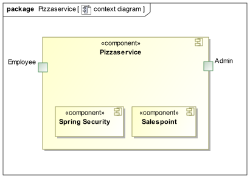

=== 5.2. Top-Level-Architektur
Top-Level-Ansicht des Systems.

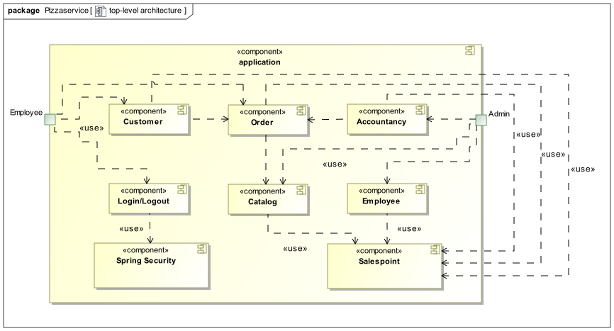

== 6. Anwendungsfälle

Dieser Abschnitt soll einen Überblick darüber geben, welche Anwendungsfälle das System unterstützen muss. Diese Anwendungsfälle beschreiben welche Funktionalität das System aus der Sicht des Klienten bereitstellen muss und welche Akteure beteiligt sind.

[[akteure]]
=== 6.1 Akteure
Hier werden die Akteure als Nutzer des Systems beschrieben.
Die nachfolgende Tabelle fasst alle Akteure des Systems zusammen.

[options="header"]
[cols="1,4"]
|===
|*Name* |*Beschreibung*
|Mitarbeiter a|
Ein registrierter und authentifizierter Nutzer des Systems, welcher (unter anderem) für:

- die Kommunikation mit dem Kunden,
- Aufnahme von Bestellungen,
- Zubereitung von Pizzas und
- Auslieferung von Bestellungen

verantwortlich sein kann.
|Admin| Ein registrierter und authentifizierter Nutzer des Systems, welcher für die Administration der Anwendung verantwortlich ist.
Er ist auch ein Mitarbeiter, welcher aber mit der Rolle "ADMIN" im System gekennzeichnet ist und damit höhere Befugnisse hat.
|===

=== 6.2 Anwendungsfalldiagramm
[[Anwendungsfalldiagramm]]
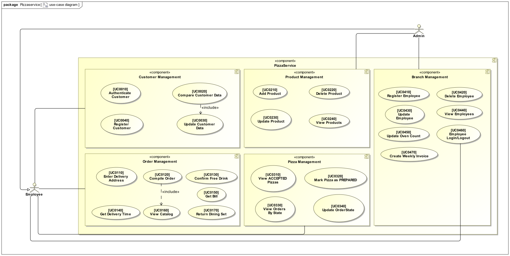

=== 6.3 Anwendungsfallbeschreibungen
Dieser Abschnitt beschreibt die Anwendungsfälle aus dem Anwendungsfalldiagramm genauer.

[cols="1h, 3"]
[[UC0010]]
|===
|*ID* |**<<UC0010>>**
|*Name* |Kunde authentifizieren
|*Beschreibung* | Ein Mitarbeiter soll einen Kunden authentifizieren können.
|*Akteure* | Mitarbeiter
|*Trigger* | Mitarbeiter drückt auf "Kunden authentifizieren"
|*Vorbedingungen* a|
- Kunde ist registriert
|*Essenzielle Schritte* a|
. Mitarbeiter drückt auf "Kunden authentifizieren"
. Mitarbeiter gibt die Telefonnummer und TAN des Kunden ein
. Mitarbeiter drückt auf "Anmelden"
.. falls ein Kunde mit diesen Zugangsdaten im System existiert: Mitarbeiter wird zur Startseite zurückgeleitet
.. ansonsten: eine Fehlermeldung wird angezeigt
|*Erweiterungen* | -
|*Funktionale Anforderungen*| <<F0000>>, <<F0010>>
|===

[cols="1h, 3"]
[[UC0020]]
|===
|*ID* |**<<UC0020>>**
|*Name* | Kundendaten abgleichen
|*Beschreibung* | Ein Mitarbeiter soll die Daten eines Kunden überprüfen können.
|*Akteure* | Mitarbeiter
|*Trigger* | Mitarbeiter drückt auf "Kundendaten abgleichen"
|*Vorbedingungen* a|
- Kunde ist authentifiziert
|*Essenzielle Schritte* a|
. Mitarbeiter drückt auf "Kundendaten abgleichen"
. Mitarbeiter bekommt ein vorausgefülltes Formular mit den Kundendaten angezeigt
. Mitarbeiter gleicht Kundendaten mit dem Kunden ab (ohne Veränderungen durchzuführen) und drückt auf "Bestätigen"
. Mitarbeiter wird zur Startseite weitergeleitet
|*Erweiterungen* | -
|*Funktionale Anforderungen*| <<F0000>>, <<F0010>>, <<F0030>>
|===

[cols="1h, 3"]
[[UC0030]]
|===
|*ID* |**<<UC0030>>**
|*Name* | Kundendaten aktualisieren
|*Beschreibung* | Ein Mitarbeiter soll die Daten eines Kunden aktualisieren können.
|*Akteure* | Mitarbeiter
|*Trigger* | Mitarbeiter möchte Kundendaten abgleichen (<<UC0020>>)
|*Vorbedingungen* a|
- Kunde ist authentifiziert
|*Essenzielle Schritte* a|
* Mitarbeiter führt Änderungen am vorausgefüllten Formular für den Kunden durch und drückt auf "Bestätigen"
** falls die Eingabe korrekt war: Mitarbeiter wird zur Startseite weitergeleitet
** ansonsten: eine Fehlermeldung wird angezeigt
|*Erweiterungen* | -
|*Funktionale Anforderungen*| <<F0000>>, <<F0010>>, <<F0020>>, <<F0021>>
|===

[cols="1h, 3"]
[[UC0040]]
|===
|*ID* |**<<UC0040>>**
|*Name* |Kunde registrieren
|*Beschreibung* |Ein Mitarbeiter soll einen neuen Kunden registrieren können.
|*Akteure* |Mitarbeiter
|*Trigger* |Mitarbeiter drückt auf "Kunden registrieren" in der Navigationsleiste
|*Vorbedingungen* a|
- Kunde ist nicht registriert
|*Essenzielle Schritte* a|
. Mitarbeiter drückt auf "Kunden registrieren" in der Navigationsleiste
. Mitarbeiter gibt Name, Telefonnummer und Adresse ein
. Mitarbeiter drückt auf "Registrieren"
.. wenn die Telefonnummer nicht bereits im System existiert: TAN wird generiert und Nutzeraccount mit TAN als Passwort wird angelegt
.. ansonsten: eine Fehlermeldung wird angezeigt
. Mitarbeiter bekommt TAN des registrierten Nutzers ausgegeben
|*Erweiterungen* | TAN-Generierung erzeugt immer eine TAN, die noch nie als TAN verwendet wurde
|*Funktionale Anforderungen*| <<F0000>>, <<F0020>>, <<F0021>>, <<F0040>>
|===

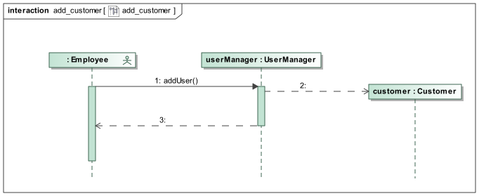

[cols="1h, 3"]
[[UC0110]]
|===
|*ID* |**<<UC0110>>**
|*Name* |Bestelladresse eingeben
|*Beschreibung* | Ein Mitarbeiter soll die Bestelladresse eines Kunden im System eingeben oder dessen Standardadresse auswählen oder die Bestellung zum Selbstabholen kennzeichen können.
|*Akteure* |Mitarbeiter
|*Trigger* a| Mitarbeiter möchte die Bestelladresse für eine Bestellung festlegen
|*Vorbedingungen* a|
- Kunde ist authentifiziert
- Mitarbeiter hat den Kundendatenabgleich (<<UC0020>>) durchgeführt
|*Essenzielle Schritte* a|
. Mitarbeiter drückt auf "Weiter" nach der Authentifizierung des Kunden
. Standardadresse:
.. Mitarbeiter setzt Haken bei "Standardadresse"
.. Mitarbeiter drückt auf "Weiter"
. Andere Adresse:
.. "Mitarbeiter setzt Haken bei "Andere Adresse"
.. Mitarbeiter gibt Adresse in vorgefertigtes Adressfeld ein
.. Mitarbeiter drückt auf "Weiter"
. Zum Abholen:
.. Mitarbeiter setzt Haken bei "Zum Abholen"
.. Mitarbeiter drückt auf "Weiter"
|*Erweiterungen* | -
|*Funktionale Anforderungen*| <<F0010>>, <<F0100>>, <<F0120>>, <<F0121>>
|===

[cols="1h, 3"]
[[UC0120]]
|===
|*ID* |**<<UC0120>>**
|*Name* |Bestellung zusammenstellen
|*Beschreibung* |Ein Mitarbeiter soll die Möglichkeit haben, die vom Kunden gewünschten Produkte der Bestellung hinzuzufügen.
|*Akteure* |Mitarbeiter
|*Trigger* |Mitarbeiter hat die Bestelladresse eingegeben (<<UC0110>>)
|*Vorbedingungen* a|
- Kunde ist authentifiziert
- Sortiment enthält mindestens ein Produkt
- Mitarbeiter hat die Bestelladresse eingegeben (<<UC0110>>)
|*Essenzielle Schritte* a|
. Mitarbeiter drückt auf "Produkt hinzufügen"
.. Mitarbeiter wählt aus um welches Produkt es sich handelt
... Pizza: Mitarbeiter wählt die gewünschten Zutaten aus und ihre Menge
... Getränk: Mitarbeiter wählt Getränk aus
... Salat: Mitarbeiter wählt Salat aus
... Essgarnitur: Mitarbeiter wählt Essgarnitur aus
.. Mitarbeiter drückt auf "Hinzufügen"
. wenn alle gewünschten Produkte hinzugefügt wurden, drückt Mitarbeiter auf "Weiter"
|*Erweiterungen* | Möglichkeit die Bestellung abzubrechen
|*Funktionale Anforderungen*| <<F0010>>, <<F0100>>, <<F0110>>, <<F0310>>
|===

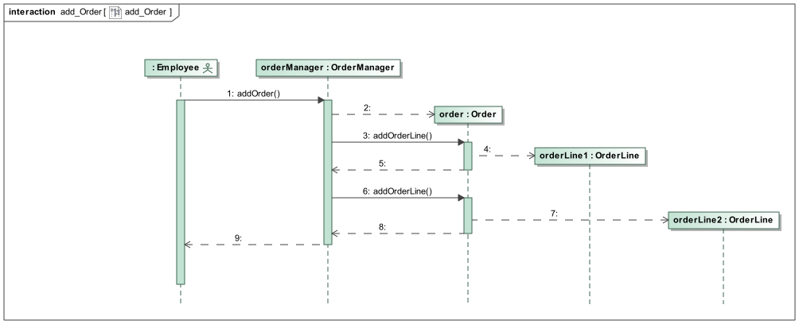

[cols="1h, 3"]
[[UC0130]]
|===
|*ID* |**<<UC0130>>**
|*Name* |Freigetränk bestätigen
|*Beschreibung* |Ein Mitarbeiter soll darauf hingewiesen werden, dass ein Freigetränk möglich ist, und soll dieses auswählen können.
|*Akteure* |Mitarbeiter
|*Trigger* |Mitarbeiter stellt eine Bestellung im Wert von über 30 € zusammen
|*Vorbedingungen* a|
- Kunde ist authentifiziert
- Mitarbeiter hat die Bestellung zusammengestellt (<<UC0120>>)
|*Essenzielle Schritte* a|
. Mitarbeiter bekommt eine Nachricht angezeigt, dass der Bestellwert über 30 € liegt und ein Freigetränk hinzugefügt werden kann
. Mitarbeiter wählt das Freigetränk aus
. Mitarbeiter drückt auf "Weiter"
|*Erweiterungen* | -
|*Funktionale Anforderungen*| <<F0010>>, <<F0100>>, <<F0140>>, <<F0310>>
|===

[cols="1h, 3"]
[[UC0140]]
|===
|*ID* |**<<UC0140>>**
|*Name* |Lieferzeit ausgeben
|*Beschreibung* |Ein Mitarbeiter soll sich die Zeit ausgegeben lassen können, welche bis zur Auslieferung der Bestellung anberaumt wird.
|*Akteure* |Mitarbeiter
|*Trigger* |Mitarbeiter schließt Zusammenstellung der Bestellung ab (<<UC0120>>/<<UC0130>>)
|*Vorbedingungen* a|
- Kunde ist authentifiziert
- Mitarbeiter hat die Bestellung zusammengestellt (<<UC0120>>)
- Mitarbeiter hat ggf. ein Freigetränk hinzugefügt (<<UC0130>>)
|*Essenzielle Schritte* a|
. Mitarbeiter bekommt Zeit ausgegeben, welche bis zur Auslieferung der Bestellung anberaumt wird
. Mitarbeiter drückt auf "Weiter"
|*Erweiterungen* | -
|*Funktionale Anforderungen*| <<F0010>>, <<F0100>>, <<F0150>>
|===

[cols="1h, 3"]
[[UC0150]]
|===
|*ID* |**<<UC0150>>**
|*Name* |Rechnung ausgeben
|*Beschreibung* |Ein Mitarbeiter soll sich die Rechnung der aktuellen Bestellung ausgeben lassen können.
|*Akteure* |Mitarbeiter
|*Trigger* |Mitarbeiter beendet Ansicht der Lieferzeit (<<UC0140>>)
|*Vorbedingungen* a|
- Kunde ist authentifiziert
- Mitarbeiter hat die Lieferzeit betrachtet (<<UC0140>>)
|*Essenzielle Schritte* a|
. Mitarbeiter bekommt Rechnung angezeigt, aufgeschlüsselt in die Preise der einzelnen Produkte und den Gesamtpreis
. Mitarbeiter drückt auf "Weiter"
|*Erweiterungen* | -
|*Funktionale Anforderungen*| <<F0010>>, <<F0100>>, <<F0160>>, <<F0310>>
|===

[cols="1h, 3"]
[[UC0160]]
|===
|*ID* |**<<UC0160>>**
|*Name* |Sortiment anzeigen
|*Beschreibung* |Einem Mitarbeiter soll die Liste aller zum Verkauf stehenden Produkte angezeigt werden können.
|*Akteure* |Mitarbeiter
|*Trigger* |Mitarbeiter möchte entweder eine Bestellung zusammenstellen (<<UC0110>>) oder nur das Sortiment betrachten
|*Vorbedingungen* a|
-
|*Essenzielle Schritte* a|
_Außerhalb einer Bestellung_:

. Mitarbeiter drückt auf "Produkte" in der Navigationsleiste
. Mitarbeiter sieht alle zum Verkauf stehenden Produkte

_Innerhalb einer Bestellung_:

. Mitarbeiter gibt die Bestelladresse ein (<<UC0110>>)
. Mitarbeiter bekommt im nächsten Schritt (<<UC0120>>) das gesamte Sortiment angezeigt
|*Erweiterungen* | -
|*Funktionale Anforderungen*| <<F0300>>, <<F0310>>
|===

[cols="1h, 3"]
[[UC0170]]
|===
|*ID* |**<<UC0170>>**
|*Name* |Essgarnitur zurückgeben
|*Beschreibung* |Ein Mitarbeiter soll eingeben können, dass eine Essgarnitur zurückgegeben wurde.
|*Akteure* |Mitarbeiter
|*Trigger* |Mitarbeiter drückt auf "Essgarnitur zurückgeben"
|*Vorbedingungen* a|
- Essgarnitur ausgeliehen von einem Kunden
|*Essenzielle Schritte* a|
. Mitarbeiter drückt auf "Bestellung erstellen"
. Mitarbeiter drückt auf "Essgarnitur Zurückgeben"
. Mitarbeiter gibt die Telefonnummer des Kunden ein
.. wenn vorhanden:
... Mitarbeiter gibt die Menge der Essgarnituren ein (Eingabe wird überprüft)
... Mitarbeiter bekommt angezeigt, ob die Rückgabe fristgemäß ist
.... fristgemäß: Mitarbeiter drückt auf "Bestätigen"
.... nicht fristgemäß: Mitarbeiter bekommt Fehlermeldung
.. wenn nicht vorhanden:
... Mitarbeiter bekommt Fehlermeldung
|*Erweiterungen* | -
|*Funktionale Anforderungen*| <<F0100>>, <<F0200>>, <<F0201>>
|===

[cols="1h, 3"]
[[UC0210]]
|===
|*ID* |**<<UC0210>>**
|*Name* |Produkt hinzufügen
|*Beschreibung* | Ein Admin soll ein Produkt in das Sortiment aufnehmen können.
|*Akteure* | Admin
|*Trigger* | Admin drückt auf "Produkt hinzufügen"
|*Vorbedingungen* a|
- Admin befindet sich auf der Sortiment-Seite (<<UC0240>>)
|*Essenzielle Schritte* a|
. Admin gibt Name, Preis, Beschreibung und Kategorie ein
. Admin drückt auf "Produkt hinzufügen"
.. falls Produkt noch nicht im Sortiment enthalten ist:
... Produkt wird mithilfe der eingegebenen Daten erstellt und dem Sortiment hinzugefügt
... hinzugefügtes Produkt wird in der Produktliste auf der Sortiment-Seite angezeigt
.. ansonsten: eine Fehlermeldung wird angezeigt
|*Erweiterungen* | -
|*Funktionale Anforderungen*| <<F0300>>, <<F0320>>, <<F0321>>, <<F0610>>
|===

[cols="1h, 3"]
[[UC0220]]
|===
|*ID* |**<<UC0220>>**
|*Name* |Produkt löschen
|*Beschreibung* | Ein Admin soll ein Produkt aus dem Sortiment entfernen können.
|*Akteure* | Admin
|*Trigger* | Admin drückt auf "Produkt löschen"
|*Vorbedingungen* a|
- Admin befindet sich auf der Sortiment-Seite (<<UC0240>>)
- ausgewähltes Produkt befindet sich im Sortiment
|*Essenzielle Schritte* a|
. Admin drückt auf "Produkt löschen" neben ausgesuchten Produkt
. Produkt wird aus dem Sortiment entfernt
. entferntes Produkt wird nicht mehr in der Produktliste angezeigt
|*Erweiterungen* | -
|*Funktionale Anforderungen*| <<F0300>>, <<F0310>>, <<F0340>>
|===

[cols="1h, 3"]
[[UC0230]]
|===
|*ID* |**<<UC0230>>**
|*Name* |Produkt bearbeiten
|*Beschreibung* | Ein Admin soll ein Produkt aus dem Sortiment bearbeiten können.
|*Akteure* | Admin
|*Trigger* | Admin drückt auf "Produkt bearbeiten" neben ausgesuchten Produkt
|*Vorbedingungen* a|
- Admin befindet sich auf der Sortiment-Seite (<<UC0240>>)
- ausgewähltes Produkt befindet sich im Sortiment
|*Essenzielle Schritte* a|
. Admin drückt auf "Produkt bearbeiten" neben ausgesuchten Produkt
. Admin wird auf Produktbearbeitungsseite mit vorausgefüllten Formular weitergeleitet
. Admin macht ggf. Änderungen an Name, Preis, Beschreibung oder Kategorie
. Admin drückt auf "Änderungen absenden"
. Admin wird zurück zur Sortiment-Seite geleitet, wo die veränderte Produktliste sichtbar ist
|*Erweiterungen* |
|*Funktionale Anforderungen*| <<F0300>>, <<F0310>>, <<F0330>>, <<F0331>>
|===

[cols="1h, 3"]
[[UC0240]]
|===
|*ID* |**<<UC0240>>**
|*Name* |Produkte anzeigen
|*Beschreibung* | Ein Admin soll alle Produkte im Sortiment sehen können.
|*Akteure* | Admin
|*Trigger* | Admin drückt auf "Produkte anzeigen" in der Navigationsleiste.
|*Vorbedingungen* a|
-
|*Essenzielle Schritte* a|
. Admin drückt auf "Produkte anzeigen" in der Navigationsleiste
. Admin sieht alle Produkte
|*Erweiterungen* | -
|*Funktionale Anforderungen*| <<F0300>>, <<F0310>>
|===

[cols="1h, 3"]
[[UC0310]]
|===
|*ID* |**<<UC0310>>**
|*Name* |zu bearbeitende Pizzen anzeigen
|*Beschreibung* | Ein Mitarbeiter soll die _akzeptierten_ Pizzas sehen können.
|*Akteure* | Mitarbeiter
|*Trigger* | Mitarbeiter drückt auf "Zubereitungsbereich" in der Navigationsleiste
|*Vorbedingungen* a|
-
|*Essenzielle Schritte* a|
. Mitarbeiter drückt auf "Zubereitungsbereich" in der Navigationsleiste
. Mitarbeiter sieht eine Liste aller Pizzen, die er noch zubereiten muss
|*Erweiterungen* | -
|*Funktionale Anforderungen*| <<F0400>>, <<F0300>>, <<F0400>>
|===

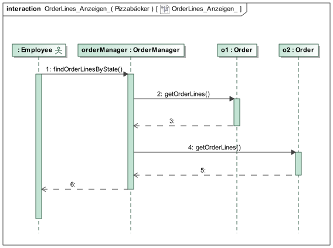

[cols="1h, 3"]
[[UC0320]]
|===
|*ID* |**<<UC0320>>**
|*Name* |Pizza als _vorbereitet_ markieren
|*Beschreibung* | Ein Mitarbeiter soll eine Pizza als _vorbereitet_ markieren können.
|*Akteure* | Mitarbeiter
|*Trigger* | Mitarbeiter drückt auf"Vorbereitet"
|*Vorbedingungen* a|
- Mitarbeiter befindet sich auf der "Zubereitungsbereich"-Seite (<<UC0310>>)
|*Essenzielle Schritte* a|
_akzeptiert_ -> _zubereitet_:

. Mitarbeiter drückt auf "Vorbereitet" neben einer Pizza in der Pizzaliste
. Status der OrderLine mit der ausgewählten Pizza wird auf _vorbereitet_ gesetzt
. Pizza wird aus der angezeigten Pizzaliste entfernt
|*Erweiterungen* | -
|*Funktionale Anforderungen*| <<F0100>>, <<F0410>>
|===

[cols="1h, 3"]
[[UC0330]]
|===
|*ID* |**<<UC0330>>**
|*Name* |Bestellungen nach Status anzeigen
|*Beschreibung* | Ein Mitarbeiter soll Bestellungen nach Status sehen können.
|*Akteure* | Mitarbeiter/Admin
|*Trigger* | Mitarbeiter drückt auf "Bestellungen anzeigen" in der Navigationsleiste
|*Vorbedingungen* a|
-
|*Essenzielle Schritte* a|
Mitarbeiter:

. Mitarbeiter drückt auf "Bestellungen anzeigen" in der Navigationsleiste
. Mitarbeiter wählt aus ob er _ausfahrbereite_ oder bereits _ausgefahrene_ Bestellungen angezeigt bekommen möchte
. Die gewünschten Bestellungen werden angezeigt

Admin:

* kann sich zusätzlich alle _abgeschlossenen_ Bestellungen anzeigen lassen
|*Erweiterungen* | -
|*Funktionale Anforderungen*| <<F0100>>, <<F0330>>
|===

[cols="1h, 3"]
[[UC0340]]
|===
|*ID* |**<<UC0340>>**
|*Name* |Bestellstatus ändern
|*Beschreibung* | Ein Mitarbeiter sollte eine Bestellung als _in_Zustellung_ oder _geliefert_ markieren können.
|*Akteure* | Mitarbeiter
|*Trigger* | Mitarbeiter möchte den Status einer Bestellung ändern
|*Vorbedingungen* a|
- Mitarbeiter sieht eine Liste von Bestellungen nach Status(<<UC0330>>)
|*Essenzielle Schritte* a|
_ausfahrbereit_ -> _in_Zustellung_:

. Mitarbeiter markiert die Bestellung als _in_Zustellung_
. ausgewählte Bestellung wird aus der angezeigten Liste von Bestellungen entfernt

_in_Zustellung_ -> _geliefert_:

. Mitarbeiter markiert die Bestellung als _geliefert_
. ausgewählte Bestellung wird aus der angezeigten Liste von Bestellungen entfernt
. Bestellung wird im System als _abgeschlossen_ markiert
. Kunde erhält eine neue TAN als Passworts
|*Erweiterungen* | TAN-Generierung erzeugt immer eine TAN, die noch nie als TAN verwendet wurde
|*Funktionale Anforderungen*| <<F0040>>, <<F0100>>, <<F0500>>, <<F0510>>, <<F0610>>
|===

[cols="1h, 3"]
[[UC0410]]
|===
|*ID* |**<<UC0410>>**
|*Name* | Mitarbeiter registrieren
|*Beschreibung* | Ein Admin soll einen neuen Mitarbeiter registrieren können.
|*Akteure* | Admin
|*Trigger* | Admin drückt auf "Mitarbeiter verwalten" in der Navigationsleiste
|*Vorbedingungen* a|
- Mitarbeiter ist noch nicht im System registriert
|*Essenzielle Schritte* a|
. Admin drückt auf "Mitarbeiter verwalten" in der Navigationsleiste
. Admin drückt auf "Mitarbeiter registrieren"
. Admin gibt die Daten des Mitarbeiters ein
. Admin drückt auf "Registrieren"
. System überprüft ob Mitarbeiter bereits vorhanden
.. wenn nicht vorhanden: zufälliges Passwort wird generiert und mit diesem ein Nutzerkonto für den Mitarbeiter im System angelegt
.. ansonsten: eine Fehlermeldung wird angezeigt
|*Erweiterungen* | -
|*Funktionale Anforderungen*| <<F0600>>, <<F0620>>, <<F0621>>, <<F0622>>
|===

[cols="1h, 3"]
[[UC0420]]
|===
|*ID* |**<<UC0420>>**
|*Name* |Mitarbeiter löschen
|*Beschreibung* | Ein Admin soll Mitarbeiter aus dem System entfernen können
|*Akteure* | Admin
|*Trigger* | Admin drückt auf "Löschen"
|*Vorbedingungen* a|
- Mitarbeiter ist im System registriert
- Admin befindet sich auf der Mitarbeiterverwaltungsseite (<<UC0440>>)
|*Essenzielle Schritte* a|
. Admin drückt auf "Löschen" neben ausgesuchten Mitarbeiter
. Mitarbeiter wird aus dem System gelöscht
. entfernter Mitarbeiter wird nicht mehr in der Mitarbeiterliste angezeigt
|*Erweiterungen* | -
|*Funktionale Anforderungen*| <<F0600>>, <<F0640>>
|===

[cols="1h, 3"]
[[UC0430]]
|===
|*ID* |**<<UC0430>>**
|*Name* |Mitarbeiter bearbeiten
|*Beschreibung* | Ein Admin soll die Daten der Mitarbeiter bearbeiten können.
|*Akteure* | Admin
|*Trigger* | Admin drückt auf "Bearbeiten"
|*Vorbedingungen* a|
- Mitarbeiter ist im System registriert
- Admin befindet sich auf der Mitarbeiterverwaltungsseite (<<UC0440>>)
|*Essenzielle Schritte* a|
. Admin drückt auf "Mitarbeiter bearbeiten" neben ausgesuchten Mitarbeiter
. Admin wird auf Mitarbeiterbearbeitungsseite mit vorausgefüllten Formular weitergeleitet
. Admin macht ggf. Änderungen an Name, Gehalt oder Passwort
. Admin drückt auf "Änderungen absenden"
. Admin wird zurück zur Mitarbeiterverwaltungsseite geleitet, wo die veränderte Mitarbeiterliste sichtbar ist
|*Erweiterungen* | -
|*Funktionale Anforderungen*| <<F0600>>, <<F0630>>, <<F0631>>
|===

[cols="1h, 3"]
[[UC0440]]
|===
|*ID* |**<<UC0440>>**
|*Name* |Mitarbeiterliste anzeigen
|*Beschreibung* | Ein Admin soll sich die Liste aller Mitarbeiter ansehen können.
|*Akteure* | Admin
|*Trigger* | Admin drückt auf "Mitarbeiter verwalten" in der Navigationsleiste
|*Vorbedingungen* a| -
|*Essenzielle Schritte* a|
. Admin drückt auf "Mitarbeiter verwalten" in der Navigationsleiste
. eine Liste alle Mitarbeiter wird angezeigt
|*Erweiterungen* | -
|*Funktionale Anforderungen*| <<F0600>>, <<F0610>>
|===

[cols="1h, 3"]
[[UC0450]]
|===
|*ID* |**<<UC0450>>**
|*Name* |Öfenanzahl aktualisieren
|*Beschreibung* | Ein Admin soll die Öfenanzahl seiner Filiale aktualisieren können.
|*Akteure* | Admin
|*Trigger* | Admin möchte die Öfenanzahl seiner Filiale aktualisieren
|*Vorbedingungen* a| -
|*Essenzielle Schritte* a|
. Admin drückt auf "Öfen anpassen" in der Navigationsleiste
. Admin sieht seine aktuelle Öfenanzahl seiner Filiale
. Admin gibt seine neue Anzahl an Öfen ein
. Admin drückt auf "Änderung absenden"
.. falls die Eingabe korrekt ist: Admin sieht die aktualisierte Öfenanzahl
.. ansonsten: eine Fehlermeldung wird angezeigt
|*Erweiterungen* | -
|*Funktionale Anforderungen*| <<F0700>>, <<F0710>>, <<F0711>>
|===

[cols="1h, 3"]
[[UC0460]]
|===
|*ID* |**<<UC0460>>**
|*Name* | Mitarbeiter Login/Logout
|*Beschreibung* | Ein Mitarbeiter soll sich einloggen können, um Zugang zum System zu erhalten.
|*Akteure* | Mitarbeiter
|*Trigger* a|
_Login_: Mitarbeiter möchte sich einloggen um Zugang zum System zu erhalten

_Logout_: Mitarbeiter möchte sich ausloggen
|*Vorbedingungen* a|
_Login_: Mitarbeiter ist registriert

_Logout_: Mitarbeiter ist eingeloggt
|*Essenzielle Schritte* a|
_Login_:

. Mitarbeiter gibt seine Logindaten ein
. Mitarbeiter drückt auf "Login"

_Logout_:

. Mitarbeiter drückt auf "Logout" in der Navigationsleiste
. Mitarbeiter wird ausgeloggt und wird auf die Startseite weitergeleitet
|*Erweiterungen* | -
|*Funktionale Anforderungen*| <<F0600>>, <<F0610>>
|===

[cols="1h, 3"]
[[UC0470]]
|===
|*ID* |**<<UC0470>>**
|*Name* |Wöchentliche Abrechnung erstellen
|*Beschreibung* | Ein Admin soll eine wöchentliche Abrechnung für seine Filiale erstellen können.
|*Akteure* | Admin
|*Trigger* | Admin möchte eine wöchentliche Abrechnung erstellen
|*Vorbedingungen* a|
- Es wurde mindestens eine Bestellung in den letzten 7 Tagen _abgeschlossen_
|*Essenzielle Schritte* a|
. Admin drückt auf "Abrechnung senden" in der Navigationsleiste
. Admin drückt auf "Abrechnung erstellen"
. Abrechnung wird mithilfe der Bestellungen der letzten 7 Tage seiner Filiale erstellt
. erstellte Abrechnung wird angezeigt
|*Erweiterungen* | -
|*Funktionale Anforderungen*| <<F0100>>, <<F0800>>
|===

== 7. Funktionale Anforderungen
Dieser Abschnitt bildet einen Überblick über die funktionalen Anforderungen des Systems.

Die Tabelle enthält:

- Einen einzigartigen Identifier der Anforderung (ID), welcher als Referenz im gesamten Projekt genutzt werden kann
- Die aktuelle Version der Anforderung, da Änderungen an der Anforderung im Projekt durchgeführt werden können
- Ein kurzer Name für die Anforderung
- Die Beschreibung der Anforderung

=== 7.1 Muss-Kriterien
[options="header", cols="2h, 1, 3, 12"]
|===
|ID
|Version
|Name
|Beschreibung

|[[F0000]]<<F0000>>
|v0.1
|Kunden a|
Das System soll Informationen zu Kunden dauerhaft speichern können.

|[[F0010]]<<F0010>>
|v0.1
|Kunde authentifizieren a|
Das System soll es einem Mitarbeiter ermöglichen, die Telefonnummer und TAN eines Kunden zu authentifizieren.

|[[F0020]]<<F0020>>
|v0.1
|Kunde registrieren a|
Das System soll einem Mitarbeiter ermöglichen, einen neuen Kunden ins System aufzunehmen.

Die folgenden Informationen müssen bereitgestellt werden:

* Telefonnummer (Benutzername, einzigartig)
* Vorname
* Nachname
* Adresse

Das System soll die Eingaben validieren (<<F0021>>) und eine TAN als Passwort generieren (<<F0040>>).

Der eingetragene Nutzer soll als Kunde im System aufgenommen werden und sich nach der Validierung der Eingaben bei der nächsten Bestellung beim Mitarbeiter authentifizieren können.

|[[F0021]]<<F0021>>
|v0.1
|Kunde registrieren validieren a|
Das System soll die bereitgestellten Daten validieren können.

* Telefonnummer muss einzigartig und eine Ziffernfolge sein
* Vorname, Nachname und Adresse dürfen nicht leer sein

Bei Verstößen gegen die genannten Vorgaben soll der Mitarbeiter über Fehlermeldungen informiert werden.

|[[F0030]]<<F0030>>
|v0.1
|Kunde bearbeiten a|
Das System soll einem Mitarbeiter ermöglichen, die Daten eines Kunden zu bearbeiten.

Dabei können folgende Daten vom Mitarbeiter bearbeitet werden:

* Telefonnummer
* Vorname
* Nachname
* Adresse

Das System soll die Eingaben validieren (<<F0031>>).

Nach der Validierung sollen die Daten des bearbeiteten Kunden im System aktualisiert werden.

|[[F0031]]<<F0031>>
|v0.1
|Kunde bearbeiten validieren a|
Das System soll die bereitgestellten Daten validieren können.

* Telefonnummer muss einzigartig und eine Zahl sein
* Vorname, Nachname und Adresse dürfen nicht leer sein

Bei Verstößen gegen die genannten Vorgaben soll der Mitarbeiter über Fehlermeldungen informiert werden.

|[[F0040]]<<F0040>>
|v0.1
|Kunden-TAN generieren a|
Das System soll eine zufällige 6-zählige TAN generieren können, die als Passwort für einen Kunden genutzt werden soll.

|[[F0100]]<<F0100>>
|v0.1
|Bestellungen a|
Das System soll Bestellungen dauerhaft speichern können.

|[[F0110]]<<F0110>>
|v0.1
|Bestellung erstellen a|
Das System soll einem Mitarbeiter ermöglichen, ein Produkt in der gewünschten Menge zur Bestellung eines authentifizierten Kunden hinzuzufügen.

Sobald ein Produkt hinzugefügt wurde, soll ein Eintrag (OrderLine) in der Bestellung des authentifizierten Kunden erstellt werden.

Eine Bestellung wird mit dem Status "OPEN" initialisiert.

Jede Pizza in einer Bestellung wird mit dem Status "ACCEPTED" initialisiert.
Jedes andere Produkt einer Bestellung wird mit dem Status "PROCESSED" initialisiert.

|[[F0120]]<<F0120>>
|v0.1
|Lieferart auswählen a|
Das System soll einem Mitarbeiter ermöglichen, die Bestelladresse bei einer Bestellung eines authentifizierten Kunden einzustellen.

Bestelladresse == Kundenadresse:

* Das System soll die Kundenadresse für die Bestellung benutzen

Bestelladresse /= Kundenadresse:

* Das System soll die Bestelladresse für die Bestellung benutzen

Abholung:

* Das System soll der Bestellung einen Rabatt hinzufügen (<<F0121>>)

|[[F0121]]<<F0121>>
|v0.1
|Rabatt für Selbstabholung hinzufügen a|
Das System soll einem Mitarbeiter ermöglichen, der Bestellung eines authentifizierten Kunden einen Rabatt von 10 % hinzuzufügen, falls dieser seine Bestellung abholen möchte.

|[[F0130]]<<F0130>>
|v0.1
|Essgarnitur hinzufügen a|
Das System soll einem Mitarbeiter ermöglichen, der Bestellung eines authentifizierten Kunden Essgarnituren hinzuzufügen.
Des weiteren soll das System die ausgelieferten Essgarnituren speichern.

|[[F0140]]<<F0140>>
|v0.1
|Freigetränk hinzufügen a|
Falls der Bestellwert 30 € überschreitet, dann soll das System einen Mitarbeiter dazu verpflichten, der aktuellen Bestellung ein beliebiges Getränk aus dem Sortiment ohne Aufpreis hinzuzufügen.

|[[F0150]]<<F0150>>
|v0.1
|Lieferzeit ausgeben a|
Das System soll bei der Erstellung einer Bestellung die voraussichtliche Lieferzeit berechnen und zurückgeben können.

|[[F0160]]<<F0160>>
|v0.1
|Rechnung ausgeben a|
Das System soll aus dem Inhalt einer zusammengestellten Bestellung eine Rechnung erzeugen und anzeigen können.

Die Rechnung sollte die folgenden Informationen anzeigen:

- Name des Produkts
- Anzahl des Produkts
- Gesamtpreis für jedes Produkt
- Gesamtpreis des Warenkorbs

|[[F0200]]<<F0200>>
|v0.1
|Essgarnitur zurückgeben a|
Das System soll einem Mitarbeiter ermöglichen, für einen authentifizierten Kunden die Rückgabe von Essgarnituren im System einzutragen.

Dabei müssen folgende Informationen bereitgestellt werden:

* Telefonnummer
* Anzahl der Essgarnituren

Das System soll die Eingaben validieren (<<F0201>>).

Bei erfolgreicher Rückgabe:

* Informationen zu ausgeliehenen Essgarnituren des Kunden werden vom System aktualisiert
* Rückgabe der Essgarnitur soll intern über eine Bestellung mit negativem Wert realisiert werden

|[[F0201]]<<F0201>>
|v0.1
|Essgarnitur zurückgeben validieren a|
Das System soll die bereitgestellten Daten validieren können.

* Telefonnummer muss eine Ziffernfolge sein, für die ein Kunde im System existiert
* Anzahl der Essgarnituren darf nicht höher sein, als die tatsächlich vom Kunden ausgeliehene Anzahl
* Rückgabe erfolgt innerhalb von vier Wochen seit dem Ausleihdatum der Essgarnitur/der ältesten Essgarnitur bei einer Anzahl > 1

Bei Verstößen gegen die genannten Vorgaben soll der Mitarbeiter über Fehlermeldungen informiert werden.

|[[F0300]]<<F0300>>
|v0.1
|Sortiment a|
Das System soll Informationen zu Produkten in einem Sortiment dauerhaft speichern können.

|[[F0310]]<<F0310>>
|v0.1
|Sortiment anzeigen a|
Das System soll einem Mitarbeiter ermöglichen, die Liste aller Produkte im Sortiment einzusehen.

Dabei sollen folgende Informationen zu jedem Produkt angezeigt werden:

* Name
* Beschreibung
* Preis
* Kategorie

|[[F0311]]<<F0311>>
|v0.1
|Sortiment einer Kategorie anzeigen a|
Das System soll einem Mitarbeiter ermöglichen, eine Liste von Produkten einer Kategorie einzusehen.

Dabei sollen folgende Informationen zu jedem Produkt angezeigt werden:

* Name
* Beschreibung
* Preis
* Kategorie

|[[F0320]]<<F0320>>
|v0.1
|Produkt hinzufügen a|
Das System sollte einem Admin ermöglichen, ein neues Produkt dem Sortiment hinzuzufügen.

Die folgenden Informationen müssen bereitgestellt werden:

* Name
* Beschreibung
* Preis
* Kategorie

Das System soll die Eingaben validieren (<<F0321>>).

Nach der Validierung soll mithilfe der Eingaben ein neues Produkt erstellt und dem Sortiment hinzugefügt werden.

|[[F0321]]<<F0321>>
|v0.1
|Produkt hinzufügen validieren a|
Das System soll die bereitgestellten Daten validieren können.

* Name, Beschreibung und Kategorie dürfen nicht leer sein
* Preis muss eine positive reelle Zahl mit maximal 2 Nachkommastellen sein

Bei Verstößen gegen die genannten Vorgaben soll der Mitarbeiter über Fehlermeldungen informiert werden.

|[[F0330]]<<F0330>>
|v0.1
|Produkt bearbeiten a|
Das System sollte einem Admin ermöglichen, ein bestehendes Produkt aus dem Sortiment zu bearbeiten.

Die folgenden Informationen müssen vom Admin bereitgestellt werden:

* Name
* Beschreibung
* Preis
* Kategorie

Das System soll die Eingaben validieren (<<F0331>>).

Nach der Validierung soll das ausgewählte Produkt mit den Eingaben aktualisiert werden.

|[[F0331]]<<F0331>>
|v0.1
|Produkt bearbeiten validieren a|
Das System soll die bereitgestellten Daten validieren können.

* Name, Beschreibung und Kategorie dürfen nicht leer sein
* Preis muss eine positive reelle Zahl mit maximal 2 Nachkommastellen sein

Bei Verstößen gegen die genannten Vorgaben soll der Mitarbeiter über Fehlermeldungen informiert werden.

|[[F0340]]<<F0340>>
|v0.1
|Produkt löschen a|
Das System sollte einem Admin ermöglichen, ein bestehendes Produkt aus dem Sortiment zu entfernen.

|[[F0400]]<<F0400>>
|v0.1
|Pizzen anzeigen a|
Das System soll einem Mitarbeiter ermöglichen, alle Pizzas mit dem Status "ACCEPTED" zu betrachten.

|[[F0410]]<<F0410>>
|v0.1
|Pizzastatus ändern a|
Das System soll einem Mitarbeiter ermöglichen, eine Pizza aus dem Status "ACCEPTED" in den Status "PREPARED" zu versetzen, wenn sie für den Ofen vorbereitet wurde.

|[[F0500]]<<F0500>>
|v0.1
|Bestellungen anzeigen a|
Das System soll dem Mitarbeiter bzw. Admin ermöglichen, Bestellungen nach Status einzusehen.

Für die Anzeige der Bestellungen wird nach folgenden Status unterschieden:

- Falls alle OrderLines einer Bestellung den Status "PROCESSED" besitzen, dann ist die Bestellung _ausfahrbereit_.
- Falls alle OrderLines einer Bestellung den Status "IN_DELIVERY" besitzen, dann ist die Bestellung _ausgefahren_.
- Falls die Bestellung den Status "COMPLETED" besitzt, dann ist die Bestellung _abgeschlossen_.

Die folgenden Informationen sollen für jede Bestellung angezeigt werden:

- Zeitstempel der Erstellung
- Zeitstempel der Archivierung (nur bei Admin)
- verantwortlicher Mitarbeiter
- zugehöriger Kunde
- Bestelladresse
- Bestandteile der Bestellung (Produkte/Rabatte)
- Gesamtpreis der Bestellung

|[[F0510]]<<F0510>>
|v0.1
|Bestellstatus ändern a|
Das System soll einem Mitarbeiter ermöglichen, den Status einer Bestellung zu ändern.

_ausfahrbereit_ -> _ausgefahren_:

- alle OrderLines der Bestellung werden von dem Status "PROCESSED" in den Status "IN_DELIVERY" versetzt

_ausgefahren_ -> _abgeschlossen_:

- Bestellung wird in den Status "COMPLETED" versetzt
- Kunde erhält eine neue TAN als Passwort (<<F0040>>)

|[[F0511]]<<F0511>>
|v0.1
|Bestellung archivieren a|
Das System soll eine Bestellung archivieren können.

Eine Bestellung wird archiviert, indem ihr Status zu "COMPLETED" gesetzt wird (<<F0340>>).

Das soll nur dann geschehen, wenn jede OrderLine der Bestellung den Status "IN_DELIVERY" besitzt.

|[[F0600]]<<F0600>>
|v0.1
|Mitarbeiter a|
Das System soll Informationen zu Mitarbeitern dauerhaft speichern können.

|[[F0610]]<<F0610>>
|v0.1
|Mitarbeiter authentifizieren a|
Um bestimmte Bereiche des Systems nutzen zu können, muss man sich authentifizieren. Wenn ein Nutzer im System existiert (Mitarbeiter bzw. Admin), dann soll er oder sie sich mit den folgenden Daten authentifizieren können:

* Benutzername
* Passwort

|[[F0620]]<<F0620>>
|v0.1
|Mitarbeiter registrieren a|
Das System soll einem Admin ermöglichen, einen neuen Mitarbeiter ins System aufzunehmen.

Die folgenden Informationen müssen bereitgestellt werden:

* Benutzername
* FilialId
* Vorname
* Nachname
* Gehalt
* Rolle (Mitarbeiter/Admin)
* Adresse

Das System soll die Eingaben validieren (<<F0621>>) und ein Passwort für den Mitarbeiter generieren (<<F0622>>).

Nach der erfolgreichen Validierung soll der registrierte Mitarbeiter mit der eingegebenen Rolle im System aufgenommen werden.
Danach soll sich der registrierte Mitarbeiter authentifizieren können.

|[[F0621]]<<F0621>>
|v0.1
|Mitarbeiter registrieren validieren a|
Das System soll die bereitgestellten Daten validieren können.

* Benutzername darf nicht bereits im System registriert sein
* Vorname, Nachname und Adresse dürfen nicht leer sein
* Gehalt und FilialId müssen positive Zahlen sein, die nicht 0 sind
* Gehalt muss eine positive reelle Zahl mit maximal zwei Nachkommastellen

Bei Verstößen gegen die genannten Vorgaben soll der Mitarbeiter über Fehlermeldungen informiert werden.

|[[F0622]]<<F0622>>
|v0.1
|Passwort generieren a|
Das System soll ein zufälliges 8-stelliges Passwort für einen Mitarbeiter generieren können.

|[[F0630]]<<F0630>>
|v0.1
|Mitarbeiter bearbeiten a|
Das System soll einem Admin ermöglichen, die Daten für einen bestehenden Mitarbeiter im System zu bearbeiten.

Die folgenden Informationen müssen bereitgestellt werden:

* Benutzername
* Vorname
* Nachname
* Gehalt
* Passwort

Das System soll die Eingaben validieren (<<F0631>>).

Nach der Validierung sollen die Daten des bearbeiteten Mitarbeiters im System aktualisiert werden.

|[[F0631]]<<F0631>>
|v0.1
|Bearbeitung Mitarbeiter validieren a|
Das System soll die bereitgestellten Daten validieren können.

* Benutzername darf nicht bereits im System registriert sein
* Vorname, Nachname und Adresse dürfen nicht leer sein
* Gehalt muss eine positive Zahl sein, die nicht 0 ist
* Passwort darf nicht weniger als 8 Zeichen enthalten

Bei Verstößen gegen die genannten Vorgaben soll der Mitarbeiter über Fehlermeldungen informiert werden.

|[[F0640]]<<F0640>>
|v0.1
|Mitarbeiter löschen a|
Das System soll einem Admin ermöglichen, einen Mitarbeiter aus dem System zu entfernen.

Der ausgewählte Mitarbeiter soll nach der Validierung aus dem System entfernt werden und sich nicht mehr authentifizieren können.

|[[F0650]]<<F0650>>
|v0.1
|Mitarbeiterliste anzeigen a|
Das System soll einem Admin ermöglichen, die Liste aller Mitarbeiter im System einzusehen.

|[[F0700]]<<F0700>>
|v0.1
|Ofen a|
Das System soll die Fertigung von Pizzas über die Öfen modellieren.

Ein Ofen ist dafür verantwortlich, dass eine Pizza vom Status "PREPARED" in den Status "PROCESSED" versetzt wird.

Dies soll im 5-Minuten-Takt, je nach Verfügbarkeit der Öfen, erfolgen.

|[[F0710]]<<F0710>>
|v0.1
|Öfenanzahl aktualisieren a|
Das System soll einem Admin ermöglichen, die Öfenanzahl seiner Filiale aktualisieren zu können.

Das System soll die Eingabe validieren (<<F0711>>).

|[[F0711]]<<F0711>>
|v0.1
|Öfenanzahl validieren a|
Die Öfenanzahl muss eine positive Zahl sein, die nicht 0 ist.

Bei einem Verstoß gegen die genannte Vorgabe soll der Admin über eine Fehlermeldung informiert werden.
|===

=== 7.2 Kann-Kriterien

[options="header", cols="2h, 1, 3, 12"]
|===
|ID
|Version
|Name
|Beschreibung
|[[F0800]]<<F0800>>
|v0.1
|Wöchentliche Abrechnung erstellen a|
Das System soll einem Admin ermöglichen, eine Wochenabrechnung für seine Filiale zu erstellen.

Die Abrechnung soll mithilfe aller Bestellungen mit dem Status "COMPLETED" der letzten 7 Tage
aus der Filiale des Admins erstellt werden.

Falls keine Bestellung in diesem Zeitraum erfolgt ist, dann soll das System dem Admin mitteilen,
dass keine Abrechnung erstellt werden kann.

|[[F0810]]<<F0810>>
|v0.1
|Bestellung canceln
|Es sollte einem Mitarbeiter möglich sein eine Bestellung auf wunsch eines Kunden zu canceln.

Diese sollte für den Pizzabäcker nicht mehr angezeigt werden und in der wöchentlichen
Abrechnung als "canceled" auftauchen.

|[[F0820]]<<F0820>>
|v0.1
|Vorbestellen
|Es sollte möglich sein zu einer Bestellung den gewünschten Lieferzeitpunkt festzulegen,
falls ein Kunde seine Bestellung ein paar Tage (oder Stunden) im voraus aufgeben möchte.

Das System sollte die Pizzen für den Pizzabäcker dann erst anzeigen wenn er sie
tatsächlich zubereiten muss.

|[[F0830]]<<F0830>>
|v0.1
|Kunden Nachfragen beantworten.
|Es sollte dem Mitarbeiter möglich sein sich die aktuellen Bestellungen eines Kunden
ansehen zu können.

Das System sollte dabei die OrderLines der Bestellung mit Status anzeigen.

|[[F0840]]<<F0840>>
|v0.1
|Bestellung der Zutaten
|Das System sollte dem Admin zu jederzeit anzeigen welche Zutaten neu bestellt werden müssen.

Die Menge in der die einzelnen Zutaten nachbestellt werden müssen orientiert sich am
Verbrauch.

|[[F0850]]<<F0850>>
|v0.1
|Öfenanzahl vorschlagen
|Das System sollte vierteljährlich berechnen wie viele Öfen jede Filiale braucht.
Wenn der Admin die Anzahl der Öfen anpasst sollte er diesen Vorschlag sehen.

|===

== 8. Nicht-Funktionale Anforderungen
Dieser Abschnitt stellt einen Überblick über nicht-funktionale Anforderungen des Projekts Pizzaservice dar. Diese Anforderungen beschreiben in welchen Grenzen das System funktionieren soll.

=== 8.1 Qualitätsziele

Die folgende Tabelle zeigt welche Qualitätsziele in welchem Maß erfüllt werden sollen. Die erste Spalte enthält die Liste der Qualitätsziele, während in den nachfolgenden Spalten die Priorität auf einer Skala von 1 bis 5 mit einem "X" eingetragen wird.

1 = nicht wichtig ... 5 = sehr wichtig

[options="header", cols="3h, ^1, ^1, ^1, ^1, ^1"]
|===
|Qualitätsziel            | 1 | 2 | 3 | 4 | 5
|Verfügbarkeit            |   |   |   | X |
|Wartbarkeit              |   |   |   | X |
|Sicherheit               |   |   | X |   |
|Benutzerfreundlichkeit   |   |   |   |   | X
|===

=== 8.2 Konkrete Nicht-Funktionale Anforderungen

[options="header", cols="2h, 1, 3, 12"]
|===
|ID
|Version
|Name
|Beschreibung

|[[NF0010]]<<NF0010>>
|v0.1
|Verfügbarkeit - Uptime a|
Das System soll mindestens **99,5 %** Uptime haben.

|[[NF0020]]<<NF0020>>
|v0.1
|Wartbarkeit - Codequalität a|
Die Entwickler sollten sich möglichst an die offiziellen Coding Rules des Softwareprojekts halten.

|[[NF0030]]<<NF0030>>
|v0.1
|Sicherheit - Passwortspeicherung a|
Die Passwörter der Mitarbeiter sollen nur als Hash-Werte mithilfe von Spring Security gespeichert werden, um Passwort-Leaks vorzubeugen.

|[[NF0040]]<<NF0040>>
|v0.1
|Benutzerfreundlichkeit - UI + Fehlermeldungen a|
Das System soll die Mitarbeiter bei der Nutzung des Systems durch intuitives UI-Design und hilfreiche Fehlermeldungen unterstützen.

|===

== 9. GUI Prototyp
Diese Kapitel enthält den Entwurf und die Navigationsmöglichkeiten und Dialoge des Systems. Es enthält auch beispielhaft einige grafische Darstellung zur geplanten Umsetzung der Oberflächen. Die Dialogkarte besitzt hierbei die höhere Priorität, da die grafische Umsetzung nur für die Nutzbarkeit des Systems relevant ist.

=== 9.1 Dialoglandkarte

Hier folgt das Übersichtsdiagramm, welches das Zusammenspiel der Masken zur Laufzeit darstellt.

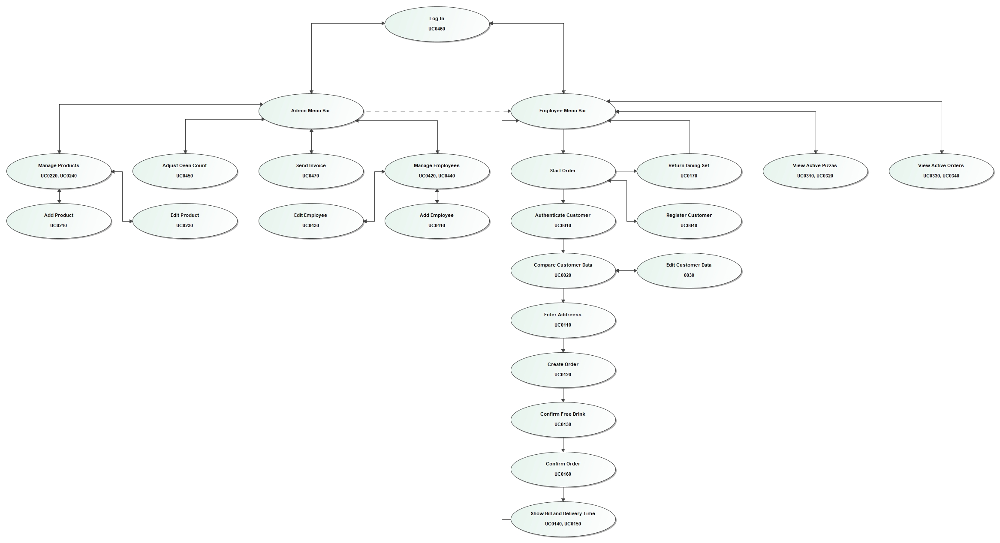

=== 9.2 Dialogbeschreibung
==== Log-In
Dieser Dialog erlaubt es einem Mitarbeiter (Administrator oder Nutzer) sich im System einzuloggen. Hierbei wird von dem Mitarbeiter ein Nutzername und ein Passwort verlangt.

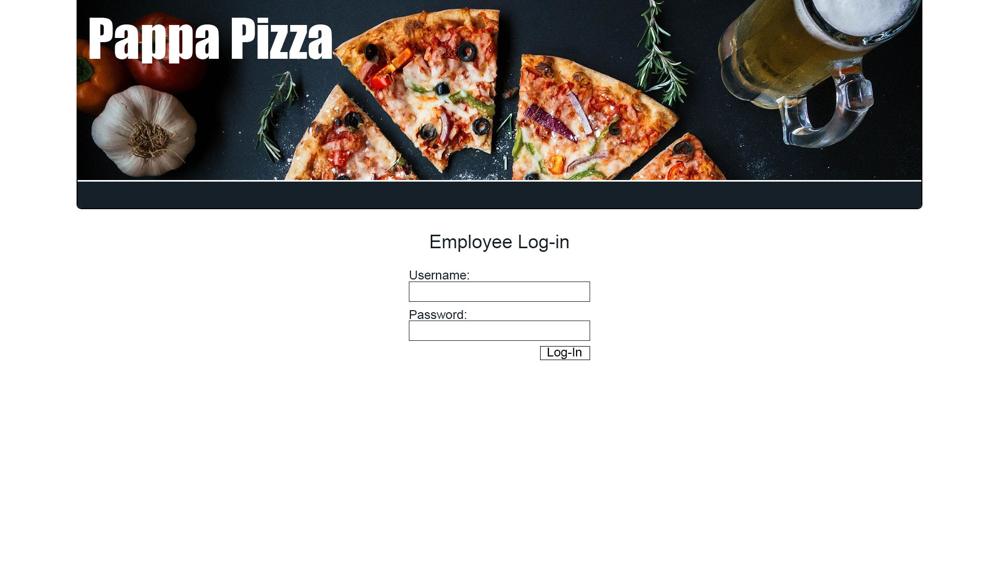

==== Employee Menu Bar
Dieser Dialog ist sichtbar, solange ein Mitarbeiter eingeloggt ist. Von hier kann der Nutzer auf die verschiedenen ihm zugänglichen Teilsysteme zugreifen. Erlaubt es dem Nutzer auch sich auszuloggen.

==== Start Order
Dieser Dialog startet den Bestellprozess für den Kunden. Falls nötig kann der Nutzer von hier auf die Kunden registrierung zugreifen.

==== Authenticate Customer
Hier gibt der Nutzer die Telefonnummer und TAN des Kunden ein um diesen zu authentifizieren.

==== Compare Customer Data
Hier sieht der Nutzer die Kundendaten des verifizierten Kunden und kann diese mit dem Kunden per Telefon vergleichen.

==== Edit Customer Data
Hier kann der Nutzer die Kundendaten anpassen.

==== Enter Customer Data
Hier kann der Nutzer vom Kunden gewünschte Änderungen eintragen.

==== Enter Address
Hier gibt der Nutzer die vom Kunden für diese Bestellung gewünschte Adresse ein.

==== Create Order
Hier werden dem Nutzer alle zm Verkauf stehenden Produkte angezeigt. Der Nutzer erstellt zusammen mit dem Kunden aus diesen eine Bestellung.

==== Confirm Free Drink
Falls der Gesamtpreis der Bestellung 30 EUR übersteigt, erhält der Nutzer hier eine Möglichkeit für den Kunden ein Freigetränk auszuwählen.

==== Confirm Order
Dem Nutzer wird die komplette Bestellung inklusive Preis angezeigt. Der Nutzer kann die Bestellung hier für den Kunden bestätigen.

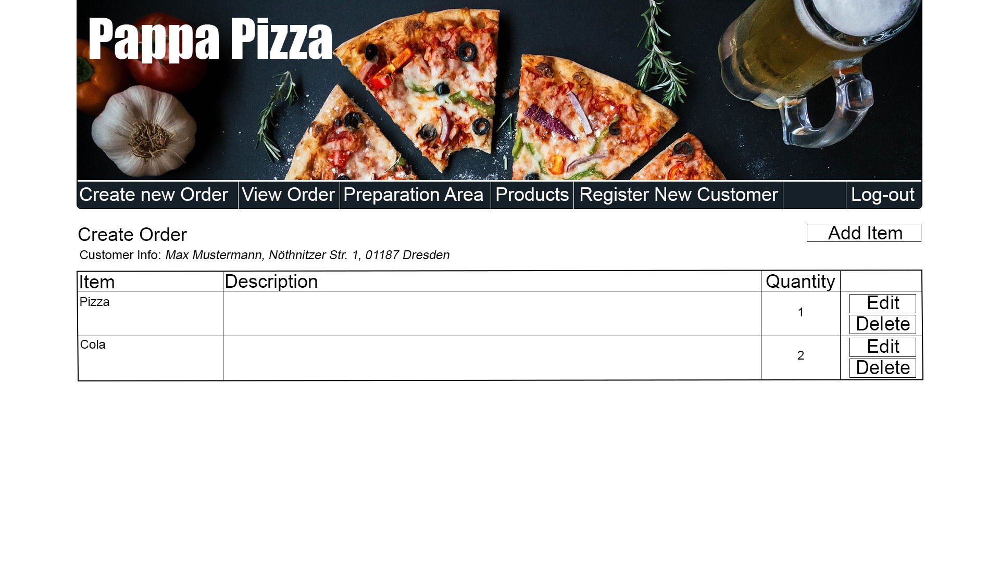

==== Show Bill and Delivery time
Der Nutzer erhält die Rechnung für die abgeschlossene Bestellung und sieht die Zeit, die zur Fertigstellung der Bestellung benötigt wird.

==== Active Orders
Der Nutzer sieht alle momentan zu bearbeitenden Bestellungen mit ihrem Status. Er kann den Status einer Bestellung verändern.

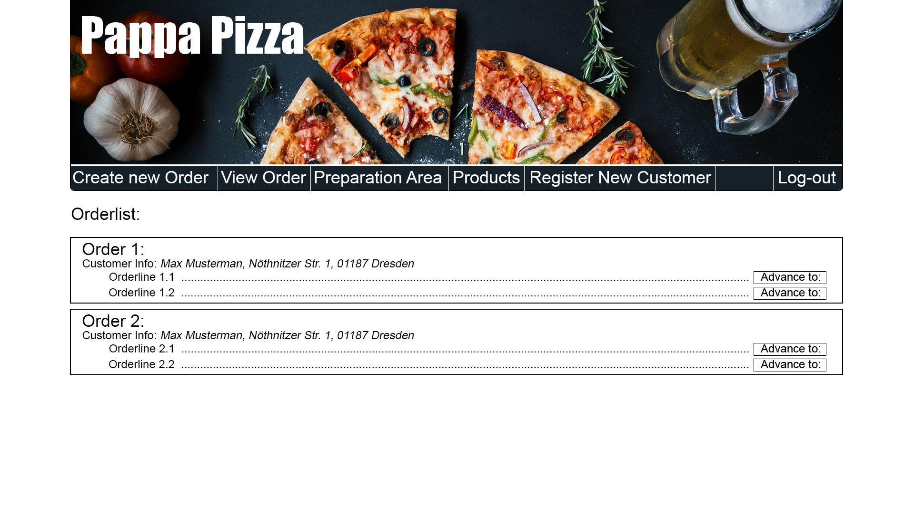

==== View Order
Der Nutzer sieht eine Bestellung mit ihren Bestandteilen. Er kann den Zustand eines Bestandteils ändern.

==== Admin Landing Page
Dieser Dialog ist immer sichtbar, wenn sich ein Admin eingeloggt hat und enthält alle Möglichkeiten der Employee Landing Page. Des Weiteren kann der Administrator auf die ihm zugänglichen Teilsystem zugreifen.

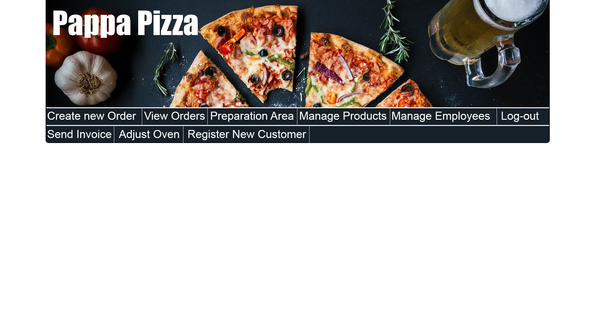

==== Manage Products
Hier kann der Administrator alle im System gespeicherten Produkte einsehen. Er hat die Möglichkeiten diese zu bearbeiten, zu löschen oder Neue hinzuzufügen.

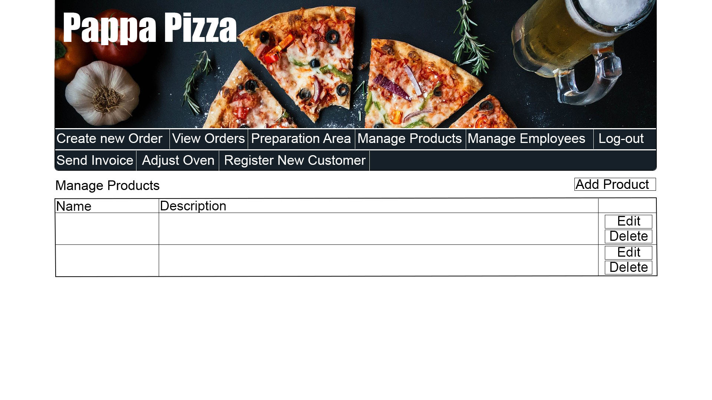

==== Manage Employees
Hier sieht der Admin alle im System gespeicherten Mitarbeiter. Er kann diese bearbeiten, löschen oder Neue hinzuzufügen. Des Weiteren kann er die Anzahl der in der Filiale vorhandenen Öfen anpassen.

==== Send Invoice
Hier kann der Administrator die wöchentliche Abrechnung erstellen.

== 10. Datenmodell
=== 10.1 Klassendiagramm
UML-Analyseklassendiagramm

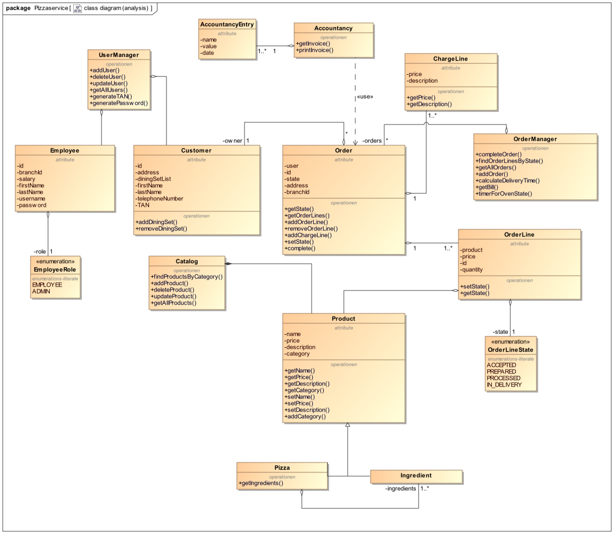

[[klassen_u_enums]]
=== 10.2 Klassen und Enumerationen
Dieser Abschnitt stellt eine Vereinigung von Glossar und der Beschreibung von Klassen/Enumerationen dar. Jede Klasse und Enumeration wird in Form eines Glossars textuell beschrieben. Zusätzlich werden eventuellen Konsistenz- und Formatierungsregeln aufgeführt.

// See http://asciidoctor.org/docs/user-manual/#tables
[options="header"]
|===
|Klasse/Enumeration |Beschreibung
|Accountancy |Die _Accountancy_ speichert _AccountancyEntrys_ und eine wöchentliche Abrechnung auszugeben.
|AccountancyEntry |Der _AccountancyEntry_ enthält Name, Wert, und Datum einer Bestellung und stellt einen Eintrag in der Buchhaltung dar.
|Catalog |Der _Catalog_ ist die Verwaltung für _Products_ und wird gleichzeitig für ihre Ausgabe genutzt.
|ChargeLine |Die _ChargeLine_ wird dafür genutzt, um Rabatte für "Abholer" umzusetzen. Sie wird an die _Order_ gehängt.
|Customer |Der _Customer_ speichert  alle für "Papa Pizza" relevanten Daten des Kunden ab und dient als Grundlage um wiederkehrende Kunden zu authentifizieren.
|Employee |Der _Employee_ stellt den "UserAccount" eines Mitarbeiter dar, mit welchem sich dieser im System einloggt.
|EmployeeRole |Da Mitarbeiter verschiedene Rollen haben können, die ihnen unterschiedliche Berechtigungen geben, enthält die _EmployeeRole_ diese.
|Ingredient | _Ingredients_ sind _Products_, die nicht als einzelnes verkauft werden können, sondern nur kombiniert in Form einer _Pizza_.
|Order |Eine _Order_ ist eine Zusammenstellung aus _OrderLines_ und verkörpert die "Bestellung". Außerdem enthält sie zudem noch _ChargeLines_.
|OrderLine |Eine _OrderLine_ repräsentiert eine Zeile in der Bestellung und enthält so ein Produkt, sowie dessen Quantität.
|OrderLineState |Der _OrderLineState_ gibt Aussage darüber aus, in welchem Verarbeitungsschritt sich die betreffende _OrderLine_ befindet.
|OrderManager |Der _OrderManager_ verwaltet die _Orders_ und ist zuständig für das Zeitmanagement der Öfen, sowie für die Ausgabe von einer approximierten Lieferzeit und der Rechnung
|Pizza |_Pizza_ ist ein spezielles _Product_, welches _Ingredients_ enthält.
|Product |Ein _Product_ stellt ein bestellbares Produkt aus der Speise- und Getränkekarte von "Papa Pizza" oder eine ausleihbare Essgarnitur dar.
|UserManager |Der _UserManger_ ist die Verwaltungsinstanz der "UserAccounts", sowohl der _Employees_, als auch der _Customer_.
|===

== 11. Akzeptanztestfälle
:Pre: Voraussetzungen
:Event: Ereignis
:Result: Erwartetes Ergebnis

[cols="1h, 4"]
[[AT0010]]
|===
|ID                  |<<AT0010>>
|Anwendungsfall      |<<UC0010>>
|{Pre} a|Das System hat registrierte Kunden.
|{Event}  a|Mitarbeiter hat Zugriff zu der Anmeldungsseite und
gibt die Anmeldeinformationen eines vorhandenen
Benutzers ein (UserName: 0351 4343434, Password: 1234) und drückt auf Button "Anmelden"
|{Result}     a|
- Kunde ist jetzt authentifiziert
- Benutzer hat nun Zugriff auf alle Funktionen,
auf der Benutzer mit der Rolle "Kunde" zugreifen kann
- es kann eine Bestellung getätigt werden
|===

[cols="1h, 4"]
[[AT0011]]
|===
|ID                  |<<AT0011>>
|Anwendungsfall      |<<UC0010>>
|{Pre} a|Ein Mitarbeiter greift auf das System zu. +
Mitarbeiter hat Zugriff auf Registrierungsseite. +
Der anrufende Kunde ist nicht registriert.
|{Event}  a|Mitarbeiter hat Zugriff zu der Anmeldungsseite und
gibt die Anmeldeinformationen eines nicht vorhandenen
Benutzers ein (UserName: 0351 4545454, Password: 1234) und drückt auf Button "Anmelden"
|{Result}     a|System gibt Fehlermeldung aus.
|===

[cols="1h, 4"]
[[AT0040]]
|===
|ID                  |<<AT0040>>
|Anwendungsfall      |<<UC0040>>
|{Pre} a|Ein Mitarbeiter verwendet das System. +
Kunde ist nicht registriert.
|{Event} a| Der Mitarbeiter drückt "Registrieren"
in der Anmeldungsseite und gibt die folgenden
Informationen ein:

- _Name:_ TestCustomer
- _Tel.:_ 0351 4545454
- _Adresse:_ Nöthnitzer Straße 46

Schließlich drückt er "Registrieren", um die Informationen
zu senden
|{Result}     a|
- neuer Kunde mit den angegebenen Daten wird erstellt
- Es ist möglich, sich mit den Anmeldeinformationen des
erstellten Kunden zu authentifizieren
- nicht authentifizierte Benutzer ist immer noch nicht authentifiziert und wird
zur Zielseite des Pizzaservice weitergeleitet
- TAN wird ausgegeben
|===

[cols="1h, 4"]
[[AT0100]]
|===
|ID                  |<<AT0100>>
|Anwendungsfall      | <<UC0030>>
|{Pre}        a|Ein Mitarbeiter verwendet das System. +
Der Kunde ist bereits authentifiziert.
|{Event}      a|Mitarbeiter führt Änderungen am vorausgefüllten Formular
für den Kunden durch und drückt auf "Bestätigen"
|{Result}     a|Die Daten des Kunden werden aktualisiert.
|===

[cols="1h, 4"]
[[AT0110]]
|===
|ID                  |<<AT0110>>
|Anwendungsfall      |<<UC0110>>
|{Pre}        a|Mitarbeiter greift auf das System zu. +
Kunde ist authentifiziert. +
Mitarbeiter hat den Kundendatenabgleich durchgeführt.
|{Event}      a|Der Mitarbeiter drückt auf "Bestellung" und wählt
zwischen "Selbstabholung", "Standardadresse" und "Andere Adresse".
|{Result}     a|Die jeweilige Wahl bzw. Eingabe wird auf der Bestellung
vermerkt und bei der Lieferung berücksichtigt.
|===

[cols="1h, 4"]
[[AT0120]]
|===
|ID                  |<<AT0120>>
|Anwendungsfall      |<<UC0120>>
|{Pre}        a|Es wird über den Account eines Mitarbeiters auf das
System zugegriffen. +
Ein Kunde wurde authentifiziert. +
Das Sortiment enthält mindestens ein Produkt. +
Die Bestelladresse wurde eingegeben.
|{Event}      a|Mann drückt auf "Produkt hinzufügen", wählt das vom
Kunden genannte Produkt aus und bestätigt mit "Hinzufügen".
|{Result}     a|Das Produkt wird zur Bestellung hinzugefügt. Das System
bietet die Möglichkeit an weitere Produkte hinzuzufügen.
|===

[cols="1h, 4"]
[[AT0130]]
|===
|ID                  |<<AT0130>>
|Anwendungsfall      |<<UC0130>>
|{Pre}        a|Es wird über den Account eines Mitarbeiters auf das
System zugegriffen. +
Ein Kunde wurde authentifiziert. +
Das Sortiment enthält mindestens ein Produkt. +
Die Bestelladresse wurde eingegeben. +
Es wurden Produkte im Wert von über 30 Euro zu Bestellung hinzugefügt.
|{Event}      a|-
|{Result}     a|Das System zeigt an, dass ein Freigetränk gewählt
werden kann.
|===

[cols="1h, 4"]
[[AT0140]]
|===
|ID                  |<<AT0140>>
|Anwendungsfall      |<<UC0140>>
|{Pre}        a|Es wird über den Account eines Mitarbeiters auf das
System zugegriffen. +
Ein Kunde wurde authentifiziert. +
Das Sortiment enthält mindestens ein Produkt. +
Die Bestelladresse wurde eingegeben. +
Es wurde mindestens ein Produkt zu Bestellung hinzugefügt.
|{Event}      a|Es wird der Button "Weiter" gedrückt.
|{Result}     a|Es wird angezeigt wie lange es voraussichtlich bis
zur Auslieferung der Bestellung dauern wird.
|===

[cols="1h, 4"]
[[AT0150]]
|===
|ID                  |<<AT0150>>
|Anwendungsfall      |<<UC0150>>
|{Pre}        a|Es wird über den Account eines Mitarbeiters auf das
System zugegriffen. +
Ein Kunde wurde authentifiziert. +
Das Sortiment enthält mindestens ein Produkt. +
Die Bestelladresse wurde eingegeben. +
Es wurde mindestens ein Produkt zu Bestellung hinzugefügt. +
Die errechnete Zeit wird angezeigt.
|{Event}      a|Mitarbeiter klickt auf "Weiter".
|{Result}     a|Es wird eine Rechnung angezeigt auf welcher der
Name des Kunden, die Lieferadresse, der Gesamtpreis
sowie die einzelnen Produkte und deren Preise stehen.
|===

[cols="1h, 4"]
[[AT0160]]
|===
|ID                  |<<AT0160>>
|Anwendungsfall      |<<UC0160>>
|{Pre}        a|Ein Mitarbeiter benutzt das System. +
Das Sortiment besteht aus mindestens einem Produkt.
|{Event}      a|Der Mitarbeiter klickt auf den Button "Menü".
|{Result}     a|Es werden alle Produkte aus dem Sortiment angezeigt.
Dabei gibt es zu jedem Produkt folgende Informationen:

- Name
- Beschreibung
- Preis
- Kategorie
|===

[cols="1h, 4"]
[[AT0170]]
|===
|ID                  |<<AT0170>>
|Anwendungsfall      |<<UC0170>>
|{Pre}        a|Ein Mitarbeiter benutzt das System. +
Der Kunde ist registriert. +
Der Kunde möchte Essgarnituren rechtzeitig zurückgeben.
|{Event}      a|Der Mitarbeiter klickt auf "Essgarnitur zurückgeben"
und gibt die Telefonnummer des Kunden ein. Anschließend gibt er die
Anzahl der Essgarnituren ein, die der Kunde zurückgeben möchte.
|{Result}     a|Das System bestätigt, dass die Essgarnituren zurückgegeben
werden können und hinterlegt eine entsprechende Rechnung im System.
Außerdem wird die Rückgabe für den Kunden vermerkt.
|===

[cols="1h, 4"]
[[AT0171]]
|===
|ID                  |<<AT0171>>
|Anwendungsfall      |<<UC0170>>
|{Pre}        a|Ein Mitarbeiter benutzt das System. +
Der Kunde ist registriert. +
Der Kunde möchte Essgarnituren zu spät zurückgeben.
|{Event}      a|Der Mitarbeiter klickt auf "Essgarnitur zurückgeben"
und gibt die Telefonnummer des Kunden ein. Anschließend gibt er die
Anzahl der Essgarnituren ein, die der Kunde zurückgeben möchte.
|{Result}     a|Das System zeigt an, dass die Frist bereits verstrichen ist.
|===

[cols="1h, 4"]
[[AT0210]]
|===
|ID                  |<<AT0210>>
|Anwendungsfall      |<<UC0210>>
|{Pre}        a|Ein Admin greift auf das Sortiment zu.
|{Event}      a|Der Admin drückt den Button "Neues Produkt"
und gibt alle Daten ein.

- Name, Kategorie und Beschreibung: Buchstaben
- Preis: positive Reelle Zahl mit zwei Nachkommastellen

Er drückt auf den Button "Produkt hinzufügen"
|{Result}     a|Das neue Produkt wird in das Sortiment
aufgenommen und angezeigt.
|===

[cols="1h, 4"]
[[AT0211]]
|===
|ID                  |<<AT0211>>
|Anwendungsfall      |<<UC0210>>
|{Pre}        a|Ein Admin greift auf das Sortiment zu.
|{Event}      a|Der Admin drückt den Button "Neues Produkt"
Er gibt alle Daten ein.

- Name, Kategorie und Beschreibung: Buchstaben
- Preis: negative Reelle Zahl mit zwei Nachkommastellen

Er drückt auf den Button "Produkt hinzufügen"
|{Result}     a|Das System gibt eine Fehlermeldung und
das Produkt wird nicht hinzugefügt.
|===

[cols="1h, 4"]
[[AT0220]]
|===
|ID                  |<<AT0220>>
|Anwendungsfall      |<<UC0220>>
|{Pre}        a|Ein Admin greift auf das Sortiment zu. +
Es ist mindestens ein Produkt im Sortiment gespeichert.
|{Event}      a|Es wird der Button "Löschen" neben einem
angezeigten Produkt gedrückt.
|{Result}     a|Das Produkt wird aus dem Sortiment gelöscht
und nicht mehr angezeigt.
|===

[cols="1h, 4"]
[[AT0230]]
|===
|ID                  |<<AT0230>>
|Anwendungsfall      |<<UC0230>>, <<UC0240>>
|{Pre}        a|Ein Admin greift auf das Sortiment zu. +
Es ist mindestens ein Produkt im Sortiment gespeichert.
|{Event}      a|Der Admin drückt auf einen Button "Sortiment"
in der Navigationsleiste. Anschließend klickt er
neben einem angezeigten Produkt auf einen Button
"Produkt bearbeiten" und gibt die Änderungen ein.

- Name, Kategorie und Beschreibung: Buchstaben
- Preis: positive Reelle Zahl mit zwei Nachkommastellen

Nach Eingabe der Daten wird der Button "Änderungen absenden"
gedrückt.
|{Result}     a|Erst werden alle momentan im Sortiment
vorhandenen Produkte angezeigt. Nach Betätigung des Buttons
"Änderungen absenden" werden die alten Daten im System ersetzt.
|===

[cols="1h, 4"]
[[AT0330]]
|===
|ID                  |<<AT0330>>
|Anwendungsfall      |<<UC0330>>, <<UC0310>>
|{Pre}        a|Es wird vom Account eines
Mitarbeiters auf das System zugegriffen. +
Es gibt mindestens eine Bestellung zu jedem
Status im System.
|{Event}      a|Der Mitarbeiter klickt auf den
Button "Bestellungen anzeigen" oder "Zubereitungsbereich"
in der Navigationsleiste und wählt
anschließend aus, zu welchem Status er die
Bestellungen sehen möchte.
|{Result}     a|Es werden nur Bestellungen
des entsprechenden Status angezeigt.
|===

[cols="1h, 4"]
[[AT0340]]
|===
|ID                  |<<AT0340>>
|Anwendungsfall      |<<UC0340>>, <<UC0320>>
|{Pre}        a|Ein Mitarbeiter verwendet das System. +
Es gibt mindestens eine Bestellung im System
die nicht zugestellt ist.
|{Event}      a|Der Mitarbeiter markiert eine
Bestellung als für ihn nicht mehr relevant. +
Mögliche Status:

- akzeptiert
- zubereitet
- ausfahrbereit
- in_Zustellung
- geliefert
|{Result}     a|Der Status der Bestellung im
System wird genau um eins weiter gesetzt.

- von akzeptiert auf zubereitet
- von ausfahrbereit zu in_Zustellung
- von in_Zustellung auf geliefert
|===

[cols="1h, 4"]
[[AT0410]]
|===
|ID                  |<<AT0410>>
|Anwendungsfall      |<<UC0410>>
|{Pre}        a|Es wird über den Account eines
Admin auf die Mitarbeiterverwaltung zugegriffen.
|{Event}      a|Es wird auf den Button
"Mitarbeiter registrieren" in der Navigationsleiste
gedrückt und die Daten des neuen Mitarbeiters
eingegeben.

- Gehalt: positive Reelle Zahl mit zwei
Nachkommastellen
- Name: Buchstaben
- Adresse/Passwort: Buchstaben und Zahlen

Zum Schluss wird auf den Button "Registrieren"
gedrückt.
|{Result}     a|Der neue Mitarbeiter ist im
System registriert und hat somit einen Account
und wird in Abrechnungen berücksichtigt.
|===

[cols="1h, 4"]
[[AT0411]]
|===
|ID                  |<<AT0411>>
|Anwendungsfall      |<<UC0410>>
|{Pre}        a|Es wird über den Account eines
Admin auf die Mitarbeiterverwaltung zugegriffen.
|{Event}      a|Es wird auf den Button
"Mitarbeiter registrieren" in der Navigationsleiste
gedrückt und die Daten des neuen Mitarbeiters
eingegeben.

- Gehalt: positive Reelle Zahl mit zwei
Nachkommastellen
- Name: Zahlen
- Adresse/Passwort: Buchstaben und Zahlen

Zum schluss wird auf den Button "Registrieren"
gedrückt.
|{Result}     a|Das System gibt eine Fehlermeldung zurück.
|===

[cols="1h, 4"]
[[AT0420]]
|===
|ID                  |<<AT0420>>
|Anwendungsfall      |<<UC0420>>
|{Pre}        a|Es wird über den Account eines
Admin auf die Mitarbeiterverwaltung zugegriffen. +
Es ist mindestens ein Mitarbeiter im System
registriert.
|{Event}      a|Der Admin drückt auf den Button
"Löschen" neben einem angezeigten Mitarbeiter.
|{Result}     a|Der entsprechende Mitarbeiter
wird aus dem System gelöscht und wird nirgends
mehr angezeigt.
|===

[cols="1h, 4"]
[[AT0430]]
|===
|ID                  |<<AT0430>>
|Anwendungsfall      |<<UC0430>>
|{Pre}        a|Es wird über den Account eines
Admin auf die Mitarbeiterverwaltung zugegriffen. +
Es ist mindestens ein Mitarbeiter im System
registriert.
|{Event}      a|Der Admin drückt auf den Button
"Mitarbeiter bearbeiten" neben einem angezeigten
Mitarbeiter. In einem oder mehreren
der angezeigten Datenfelder
ändert er einen Eintrag sinnvoll.

- Gehalt: positive Reelle Zahl mit zwei
Nachkommastellen
- Name: Buchstaben
- Adresse/Passwort: Buchstaben und Zahlen

Anschließend wird auf den Button "Änderungen absenden"
gedrückt.
|{Result}     a|Die Daten im System werden mit
dem eingegebenen Änderungen ersetzt.
|===

[cols="1h, 4"]
[[AT0431]]
|===
|ID                  |<<AT0431>>
|Anwendungsfall      |<<UC0430>>
|{Pre}        a|Es wird über den Account eines
Admin auf die Mitarbeiterverwaltung zugegriffen. +
Es ist mindestens ein Mitarbeiter im System
registriert.
|{Event}      a|Der Admin drückt auf den Button
"Mitarbeiter bearbeiten" neben einem angezeigten
Mitarbeiter. In einem oder mehreren
der angezeigten Datenfelder
ändert er einen Eintrag sinnvoll.

- Gehalt: positive Reelle Zahl mit acht
Nachkommastellen
- Name: Buchstaben
- Adresse/Passwort: Buchstaben und Zahlen

Anschließend wird auf den Button "Änderungen absenden"
gedrückt.
|{Result}     a|Das System zeigt einen Fehler. Die alten
Daten werden beibehalten.
|===

[cols="1h, 4"]
[[AT0440]]
|===
|ID                  |<<AT0440>>
|Anwendungsfall      |<<UC0440>>
|{Pre}        a|Es wird über den Account eines
Admin auf die Mitarbeiterverwaltung zugegriffen. +
Es ist mindestens ein Mitarbeiter im System
registriert.
|{Event}      a|Es wird auf den Button
"Mitarbeiter verwalten" in der Navigationsleiste
geklickt.
|{Result}     a|Das System zeigt eine Liste
aller zu diesem Zeitpunkt registrierten
Mitarbeiter an.
|===

[cols="1h, 4"]
[[AT0450]]
|===
|ID                  |<<AT0450>>
|Anwendungsfall      |<<UC0450>>
|{Pre}        a|Es wird über den Account des
Admin auf das System zugegriffen.
|{Event}      a|Der Admin drückt auf den Button
"Öfen" in der Navigationsleiste und
gibt in das Feld eine Natürliche
Zahl ein. Anschließen drückt er auf den Button
"Absenden".
|{Result}     a|Die Zahl, welche aktuell für die
Anzahl der Öfen in dieser Filiale eingetragen
ist, wird mit der eingegebenen Zahl ersetzt.
|===

[cols="1h, 4"]
[[AT0460]]
|===
|ID                  |<<AT0460>>
|Anwendungsfall      |<<UC0460>>
|{Pre}        a|Ein registrierter Mitarbeiter
benutzt das System.
|{Event}      a|Der Mitarbeiter klickt auf den
Button "Login" in der Navigationsleiste.
Dort gibt er ein:

- Name
- Passwort

Anschließen drückt er auf den Button "Login"
|{Result}     a| Der Mitarbeiter ist mit seinem
Account eingeloggt und kann auf das System als
Mitarbeiter zugreifen.
|===

[cols="1h, 4"]
[[AT0470]]
|===
|ID                  |<<AT0470>>
|Anwendungsfall      |<<UC0470>>
|{Pre}        a|Es wurde in den letzten sieben
Tagen eine Bestellung abgeschlossen. +
Es wird über den Account des Admin auf das System
zugegriffen.
|{Event}      a|Es wird auf den Button
"Abrechnung erstellen" geklickt.
|{Result}     a|Das System erstellt eine Abrechnung
die alle Bestellungen der letzten sieben Tage
und Ausgaben wie Gehälter enthält. Diese wird
auf dem Bildschirm angezeigt.
|===

== 12. Glossar
Sämtliche Begriffe, die innerhalb des Projektes verwendet werden und deren gemeinsames Verständnis aller beteiligten Stakeholder essenziell ist, sollten hier aufgeführt werden.
Insbesondere Begriffe der zu implementierenden Domäne wurden bereits beschrieben, jedoch gibt es meist mehr Begriffe, die einer Beschreibung bedürfen. +
Beispiel: Was bedeutet "Kunde"? Ein Nutzer des Systems? Der Kunde des Projektes (Auftraggeber)?

[options="header"]
|===
|Begriff |Beschreibung

|Accountancy |Siehe <<klassen_u_enums, Klassen und Enumerationen>>
|AccountancyEntry |Siehe <<klassen_u_enums, Klassen und Enumerationen>>
|Admin| Verwalter der Mitarbeiter- und Produkte-Datenbank +
Siehe <<akteure, Akteure>>
|Benutzer/Nutzer |Registrierter Mitarbeiter
|Catalog |Siehe <<klassen_u_enums, Klassen und Enumerationen>>
|ChargeLine |Siehe <<klassen_u_enums, Klassen und Enumerationen>>
|Customer |Siehe <<klassen_u_enums, Klassen und Enumerationen>>
|Employee |Siehe <<klassen_u_enums, Klassen und Enumerationen>>
|EmployeeRole |Siehe <<klassen_u_enums, Klassen und Enumerationen>>
|Kunden| Kunde von "Papa Pizza" +
-> kommuniziert mit Mitarbeiter, kein Systemnutzer
|Ingredient |Siehe <<klassen_u_enums, Klassen und Enumerationen>>
|Mitarbeiter|Siehe <<akteure, Akteure>>
|Order |Siehe <<klassen_u_enums, Klassen und Enumerationen>>
|OrderLine |Siehe <<klassen_u_enums, Klassen und Enumerationen>>
|OrderLineState |Siehe <<klassen_u_enums, Klassen und Enumerationen>>
|OrderManager |Siehe <<klassen_u_enums, Klassen und Enumerationen>>
|Pizza |Siehe <<klassen_u_enums, Klassen und Enumerationen>>
|Product |Siehe <<klassen_u_enums, Klassen und Enumerationen>>
|TAN |Nummer, die einem Kunden mitgeteilt wird, sodass er sich später damit authentifizieren kann.
|UserManager |Siehe <<klassen_u_enums, Klassen und Enumerationen>>
|===
